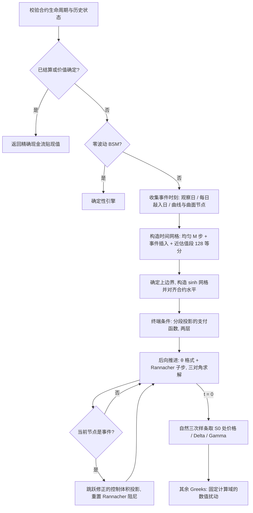

# Kiyosi 自动赎回结构（雪球、凤凰）有限差分定价：原理、实现与验证报告

> 适用版本：Kiyosi 0.19.0（提交 `fb6ea0f6`）。
> 验证环境：Windows x64，Rust release 构建，Python 3.15.1，QuantLib 1.44，NumPy 2.5.4。
> 本报告中的数值结果均由附录 B 所列脚本实际运行得到，可以复现。

## 目录

1. [摘要](#1-摘要)
2. [产品定义与支付结构](#2-产品定义与支付结构)
3. [数学模型](#3-数学模型)
4. [边界条件与计算域](#4-边界条件与计算域)
5. [数值离散化与算法实现](#5-数值离散化与算法实现)
6. [各项数值方法解决的问题及必要性](#6-各项数值方法解决的问题及必要性)
7. [验证方法论与独立参考解](#7-验证方法论与独立参考解)
8. [验证结果：凤凰](#8-验证结果凤凰)
9. [验证结果：雪球](#9-验证结果雪球)
10. [仓库测试套件](#10-仓库测试套件)
11. [误差预算、局限与使用建议](#11-误差预算局限与使用建议)
12. [结论](#12-结论)
13. [附录 A：源码索引](#附录-a源码索引)
14. [附录 B：复现脚本](#附录-b复现脚本)

---

## 1. 摘要

Kiyosi 把雪球（`SnowballOption`）、二元雪球（`BinarySnowballOption`）、三元雪球（`TernarySnowballOption`）和凤凰（`PhoenixOption`）统一建模为自动赎回票据 `AutocallableNote<T>`：它们共享离散敲出观察、可选的敲入障碍和到期结算，只在敲出支付、观察日票息和敲入后的到期支付上存在差异。`FiniteDifferenceAutocallableEngine` 使用统一的求解器为这四类产品定价，支持 Black–Scholes–Merton（BSM，含确定性利率与股息期限结构）以及局部波动率模型，核心算法采用带事件投影的一维有限差分法，主要组成如下：

- **双层状态 PDE**：每日敲入且敲入会改变支付时，分别求解“未敲入”和“已敲入”两个价值函数，在每个交易日观察点通过跳跃条件耦合。
- **合约水平对齐的非均匀网格**：敲出、凤凰票息障碍、敲入及上下行权价都精确放在网格节点上，节点在这些水平附近按 sinh 规律加密。
- **满足 M-矩阵条件的三点格式**：低波动时自动加入最小迎风扩散，保持非负性和单调性。
- **Rannacher 阻尼的 Crank–Nicolson 时间推进**：每次事件后重新施加阻尼，消除不光滑数据在 CN 格式中引起的振荡。
- **跳跃修正的控制体积投影**：在含间断的单元内对跳跃量做分段两点 Gauss–Legendre 积分平均，消除障碍位置相对网格产生的“锯齿”误差。
- **样条取值和原生 Greeks**：用自然三次样条在任意现货处取价格、Delta 和 Gamma，并带过冲保护。

本报告构造了三类与 Kiyosi 源码完全独立的参考解：基于 QuantLib `BlackCalculator` 的静态复制解析解、障碍精确对齐的转移密度卷积法（二阶收敛，Richardson 外推后误差界约 $10^{-8}$）、按事件日精确抽样的几何布朗运动 Monte Carlo（最多 6400 万条路径）。凤凰和雪球各用一份标准一年期月度合约作为基准（第 7.4 节），主要检验结果如下：

| 检验 | 凤凰（第 8 节） | 雪球（第 9 节） |
|---|---|---|
| 到期敲入基准，默认网格（800×400） | 误差 $5.6\times10^{-7}$ | 误差 $7.4\times10^{-7}$ |
| 每日敲入基准，默认网格 | 误差 $6.3\times10^{-5}$；6400×3200 时 $1.4\times10^{-6}$ | 误差 $1.04\times10^{-4}$；6400×3200 时 $2.3\times10^{-6}$ |
| 空间 / 时间收敛阶（Rannacher） | 2.0–2.4 / 1.9–2.1 | 1.7–2.6 / 1.9–2.2，均符合二阶理论 |
| 无阻尼 Crank–Nicolson | 误差在 $\pm3\times10^{-3}$ 间摆动，事件前 Gamma 达 $1.3\times10^{3}$ | 误差在 $\pm5\times10^{-3}$ 间摆动，事件前 Gamma 达 $2.3\times10^{3}$；必须使用 Rannacher 阻尼 |
| QuantLib 静态复制解析基准 | 126 组，默认网格最大误差 $7.8\times10^{-5}$ | 105 组（含二元、三元），默认网格最大误差 $4.0\times10^{-5}$；加密后均按二阶降至 $10^{-7}$ 量级 |
| 参数扫描，加密网格最大误差 | 30 组：$2.5\times10^{-6}$ | 29 组：$4.1\times10^{-6}$ |
| 与独立 Monte Carlo 的差异 | 0.14–0.58 个标准误 | 0.23–0.84 个标准误 |
| Delta、Gamma、Vega 与独立参考数值导数 | 相对偏差约 $10^{-4}$ | 相对偏差约 $10^{-4}$；距每日敲入线 2.9% 处 Gamma 为 0.9% |
| 局部波动率：常数曲面与 BSM | 差值为 0.0 | 差值为 0.0 |
| 局部波动率：偏斜曲面与独立 Euler MC | 0.4–0.9 个标准误 | 每日敲入 0.9 个标准误；到期敲入差 $4.9\times10^{-5}$（3.0 个标准误，原因待查，见第 9.9 节） |
| 仓库内 Rust 和 Python 相关测试 | 全部通过（第 10 节） | 全部通过（第 10 节） |

结论：在本报告覆盖的条款与市场参数范围内，该引擎对四类自动赎回产品的计算结果准确，实测收敛阶与理论一致，在事件附近保持数值稳定，各项独立验证结果相互吻合。每日敲入合约在默认时间步数下会引入约 $10^{-4}$ 量级的离散误差，若需更高精度，建议设置 `time_step_count ≥ 1600`（详见第 11 节）。

---

## 2. 产品定义与支付结构

### 2.1 统一的合约模型

四类产品都是 `AutocallableNote<T>`，`T` 取 `SnowballTerms`、`BinarySnowballTerms`、`TernarySnowballTerms` 或 `PhoenixTerms`。每种条款通过内部的统一视图（`sealed::View`）暴露同一组要素：观察日序列、锁定期、可选的敲入障碍（含敲入后的到期支付方式：亏损参与 `Downside` 或固定票息 `FixedCoupon`）、票息类型（雪球年化到期票息或凤凰每期票息）、本金和历史状态。引擎只读这个视图，所以四类产品共用一条定价路径。各产品共有的条款如下：

| 符号 | 字段 | 含义 |
|---|---|---|
| $t_0$ | `effective_time` | 生效时刻，雪球票息从此开始计息 |
| $t_1<\dots<t_n\le T$ | `autocall_observations` | 敲出（凤凰还包括票息）观察日，最后一期可以等于到期日 $T$ |
| $B^{\text{out}}_k$ | `knock_out_level` | 第 $k$ 期敲出水平，含等号：$S\ge B^{\text{out}}_k$ 时敲出 |
| $B^{\text{in}}$ | `knock_in_level` | 敲入水平，严格不等：$S<B^{\text{in}}$ 时敲入（二元雪球没有敲入） |
| — | `knock_in_observation` | 每个交易日（指定时钟时刻）观察，或仅在到期日观察 |
| $P$ | `principal_redemption_ratio` | 归一化本金，默认为 1 |
| — | `barrier_state` | 估值时刻之前的事件历史：`no_event`、`knocked_in`、`knocked_out` 或未知 |
| — | `calendar` | 合约交易日历，决定每日敲入的监测日 |

各产品特有的条款：

| 产品 | 特有字段 | 含义 |
|---|---|---|
| 雪球 `SnowballOption` | $r_k$ = 观察记录的 `coupon_rate`；$c_m$ = `maturity_coupon_rate`；$S_{\text{ref}},U,L$ = `initial_spot`、`upper_strike`、`lower_strike` | 年化敲出票息（可逐期不同）、年化到期票息、敲入后亏损的参考价和上下行权价 |
| 三元雪球 `TernarySnowballOption` | $r_k$、$c_m$；$c_{\min}$ = `minimum_coupon_rate` | 敲入后到期改付年化最低票息 $c_{\min}\le c_m$，没有亏损参与 |
| 二元雪球 `BinarySnowballOption` | $r_k$、$c_m$ | 没有敲入障碍，未敲出时到期支付 $c_m$ |
| 凤凰 `PhoenixOption` | $B^c_k$ = `coupon_barrier_level`；$c$ = `coupon_per_period`；$\ell$ = `lockout_periods`；$S_{\text{ref}},U,L$ | 每期票息障碍（含等号，0 表示无条件派息）、每期票息（不按期长折算）、敲出锁定期数、亏损参数 |

所有票息都可以为负。雪球的票息按 Act/365F 从 $t_0$ 计到支付日，记 $\tau_k=\tau(t_0,t_k)$、$\tau_T=\tau(t_0,T)$；也就是说，第 $k$ 期敲出时按整个持有期计息，不按观察间隔计息。雪球类产品没有锁定期字段，市场上的“前 3 个月不敲出”通过不列入这些观察日来表达。凤凰的锁定期只关闭敲出，票息和敲入照常观察；凤凰没有票息记忆，也没有到期票息。

已经发生的票息视为已结算；估值时刻恰好是观察时刻时，按当前现货计入一次。

### 2.2 现金流

记：

- $\chi_k=\mathbf 1_{\{k\ge\ell\}}$：第 $k$ 期（按 0 起计）敲出是否生效，雪球类产品 $\ell=0$；
- $Q_k$：第 $k$ 期敲出支付；$C_k(S)$：第 $k$ 期观察日票息；
- $\Pi^{(0)}(S)$、$\Pi^{(1)}(S)$：未敲出到期时，未敲入和已敲入两种状态的到期支付。

| 产品 | $Q_k$ | $C_k(S)$ | $\Pi^{(0)}(S)$ | $\Pi^{(1)}(S)$ |
|---|---|---|---|---|
| 雪球 | $P+r_k\tau_k$ | 0 | $P+c_m\tau_T$ | $P+\dfrac{\min(U,\max(L,S))-U}{S_{\text{ref}}}$ |
| 三元雪球 | $P+r_k\tau_k$ | 0 | $P+c_m\tau_T$ | $P+c_{\min}\tau_T$ |
| 二元雪球 | $P+r_k\tau_k$ | 0 | $P+c_m\tau_T$ | — |
| 凤凰 | $P$ | $c\,\mathbf 1_{\{S\ge B^c_k\}}$ | $P$ | $P+\dfrac{\min(U,\max(L,S))-U}{S_{\text{ref}}}$ |

现金流规则对四类产品相同：

- **观察日 $t_k$**：支付 $C_k(S_{t_k})$。若 $\chi_k=1$ 且 $S_{t_k}\ge B^{\text{out}}_k$，再支付 $Q_k$，合约终止。
- **敲入**：在每个监测时刻，若 $S<B^{\text{in}}$，状态转为“已敲入”且不可逆。
- **到期 $T$（未敲出）**：未敲入时支付 $\Pi^{(0)}(S_T)$，已敲入时支付 $\Pi^{(1)}(S_T)$。到期日通常也是最后一个观察日，所以 $T$ 时刻先判断票息和敲出，敲出时支付 $Q_n$ 而不是到期支付。

雪球的标准形式中 $r_k=c_m$，此时 $S_T\ge B^{\text{out}}_n$ 和 $B^{\text{in}}\le S_T<B^{\text{out}}_n$ 两种情形的到期支付相同，但两者的经济含义不同：前者是敲出，后者是“未敲入未敲出”。双票息、降落伞等变体会让两者不再相等。

这些语义集中实现在 [`autocallable.rs`](https://github.com/lilkui/kiyosi/blob/fb6ea0f626e81b4e62beff9d9c8027855e94b015/crates/kiyosi/src/instruments/autocallable.rs) 的 `observation_coupon`、`knock_out_payment`、`terminal` 和 `below_knock_in`，以及 [`pricing.rs`](https://github.com/lilkui/kiyosi/blob/fb6ea0f626e81b4e62beff9d9c8027855e94b015/crates/kiyosi/src/instruments/autocallable/pricing.rs) 的 `expiry_payment` 中。FD、求积和 Monte Carlo 三个引擎共用这一份定义，因此三者在等号、严格不等号、计息和锁定期上的处理一致。

### 2.3 预设结构

市场上常见的雪球和凤凰变体由预设展开为普通合约，引擎看到的只是展开后的条款：

| 预设 | 展开结果 |
|---|---|
| 雪球 `Standard` / `European` | 常数敲出水平与票息；每日敲入 / 仅到期敲入 |
| 雪球 `StepDown`、`BothDown` | 敲出水平（以及票息）逐期递减 |
| 雪球 `DualCoupon` | 到期票息 $c_m$ 与敲出票息 $r_k$ 分开设定 |
| 雪球 `Parachute` | 只替换最后一期的敲出水平（通常调低） |
| 雪球 `Otm`、`LossCapped` | 改变上行权价 $U$；设定下行权价 $L$ 以限制亏损 |
| 雪球 `EarlyProfit`、`Butterfly` | 按观察时间分两段或三段设定年化票息，到期票息取最后一段 |
| 凤凰 `Standard`、`StepDown` | 常数或递减敲出水平，带票息障碍 |
| 凤凰 `FixedCouponNote`、`DigitalCouponNote` | 无条件票息（FCN，$B^c=0$）或数字票息 |

因此本报告对“雪球”和“凤凰”的验证覆盖了这些预设所用的全部支付要素；第 9.5 节对其中多个变体单独做了检验。

---

## 3. 数学模型

### 3.1 标的动力学

在风险中性测度下：

$$
\frac{dS_t}{S_t}=\big(r(t)-q(t)\big)\,dt+\sigma(t,S_t)\,dW_t ,
$$

- BSM：$\sigma(t,S)\equiv\sigma$；$r(t)$ 和 $q(t)$ 由 `RateTermStructure` 给出的确定性瞬时远期利率决定，常数利率是其特例。
- 局部波动率：$\sigma(t,S)$ 由 `LocalVolatilitySurface` 按时间（Act/365F）和绝对价格做双线性插值，价格方向外推时取端点常数。

时间统一用 Act/365F 年化：$\tau(t)=\text{years\_until}(t)$。

### 3.2 分段 PDE

在两个相邻事件时刻之间，价值函数 $V(t,S)$ 满足 Feynman–Kac 后向方程：

$$
\frac{\partial V}{\partial t}+\tfrac12\sigma^2(t,S)S^2\frac{\partial^2V}{\partial S^2}+\big(r(t)-q(t)\big)S\frac{\partial V}{\partial S}-r(t)V=0 .
$$

Kiyosi 在每个时间子步上取中点的 $r$、$q$（局部波动率时还有 $\sigma$）：$r_{m}=r(t+\Delta t/2)$。

### 3.3 路径依赖的状态扩展

自动赎回产品的路径依赖有两个来源：

1. **离散敲出与票息**：只在有限个日期发生，可以用 PDE 在这些日期上的跳跃条件表示，不需要增加状态维度。雪球的敲出支付 $Q_k=P+r_k\tau_k$ 随观察日变化，但它在每个观察日是已知常数，同样只是跳跃条件的一部分。
2. **敲入状态**：敲入后到期支付不同，需要一个二值状态 $j\in\{0,1\}$（0 为未敲入，1 为已敲入）。

因此，每日敲入合约求解两个价值函数 $V^{(0)}$ 和 $V^{(1)}$。它们服从同一个微分算子，只在事件时刻耦合。到期敲入合约只在 $T$ 观察敲入，此时 $V^{(1)}$ 只在终端条件中出现，单层求解即可。代码中的条件为 `layered = daily && !knocked_in && knock_in_affects_payoff()`，其中“敲入会改变支付”按产品判断：

| 产品 | `knock_in_affects_payoff()` 为真的条件 | 不成立时 |
|---|---|---|
| 雪球 | $L\ne U$ 或 $c_m\ne0$ | $\Pi^{(0)}=\Pi^{(1)}=P$，敲入不影响价值 |
| 三元雪球 | $c_{\min}\ne c_m$ | 两层到期支付相同 |
| 二元雪球 | 永不成立（没有敲入） | 始终单层 |
| 凤凰 | $L\ne U$ | 敲入后到期仍支付 $P$ |

敲入不改变支付时，引擎不建立第二层，也不把每日监测日插入时间网格，计算量与到期敲入相同。

### 3.4 终端与跳跃条件

记 $t^{+}$ 为事件之后（时间上更晚一侧），$t^{-}$ 为事件之前；后向求解从 $t^{+}$ 推到 $t^{-}$。以下用第 2.2 节的 $Q_k$、$C_k$、$\Pi^{(0)}$、$\Pi^{(1)}$ 统一表示四类产品；$\kappa=1$ 表示该时刻也是敲入监测日。

**终端条件**（$T=t_n$；若最后一个观察日早于 $T$，去掉其中的票息和敲出项）：

$$
\begin{aligned}
V^{(1)}(T,S)&=C_n(S)+\begin{cases}Q_n,&\chi_n=1,\ S\ge B^{\text{out}}_n\\ \Pi^{(1)}(S),&\text{否则}\end{cases}\\[4pt]
V^{(0)}(T,S)&=C_n(S)+\begin{cases}Q_n,&\chi_n=1,\ S\ge B^{\text{out}}_n\\ \Pi^{(1)}(S),&\kappa=1,\ S<B^{\text{in}}\\ \Pi^{(0)}(S),&\text{否则}\end{cases}
\end{aligned}
$$

**观察日 $t_k<T$**：

$$
\begin{aligned}
V^{(1)}(t_k^-,S)&=C_k(S)+\begin{cases}Q_k,&\chi_k=1,\ S\ge B^{\text{out}}_k\\ V^{(1)}(t_k^+,S),&\text{否则}\end{cases}\\
V^{(0)}(t_k^-,S)&=C_k(S)+\begin{cases}Q_k,&\chi_k=1,\ S\ge B^{\text{out}}_k\\ V^{(1)}(t_k^+,S),&\kappa=1,\ S<B^{\text{in}}\\ V^{(0)}(t_k^+,S),&\text{否则}\end{cases}
\end{aligned}
$$

**纯敲入监测日**（每日敲入的非观察交易日）：$V^{(0)}(t^-,S)=V^{(1)}(t^+,S)$（当 $S<B^{\text{in}}$），其余情况保持不变。

**估值时刻处理**（`pricing::initial`）：

- 已敲出：价值为 0。
- 估值时刻是每日监测时刻且 $S_0<B^{\text{in}}$：立即视为已敲入。
- 估值时刻是观察日：用 $S_0$ 计入当期票息，若敲出则直接结算。
- 估值时刻是到期日：直接返回终端支付。

### 3.5 各产品的间断结构

数值难度主要取决于跳跃条件和终端条件在 $S$ 方向上的间断。以第 7.4 节的两份基准合约为例（$\tau_T\approx1$）：

| 位置 | 凤凰基准 | 雪球基准 | 三元雪球 | 二元雪球 |
|---|---|---|---|---|
| 到期 $B^{\text{in}}$ 处（未敲入层） | 跳跃 $(U-B^{\text{in}})/S_{\text{ref}}=0.30$ | 跳跃 $c_m\tau_T+(U-B^{\text{in}})/S_{\text{ref}}\approx0.45$ | 跳跃 $(c_m-c_{\min})\tau_T\approx0.12$ | 无 |
| 到期 $B^{\text{out}}_n$ 处 | 已敲入层跳跃 $(U-B^{\text{out}}_n)^+/S_{\text{ref}}$（基准中为 0） | 未敲入层在 $r_n=c_m$ 时连续；已敲入层跳跃 $r_n\tau_T+(U-B^{\text{out}}_n)^+/S_{\text{ref}}\approx0.15$ | 未敲入层同雪球；已敲入层跳跃 $(r_n-c_{\min})\tau_T$ | $r_n\ne c_m$ 时跳跃 $(r_n-c_m)\tau_T$ |
| 观察日 $B^{\text{out}}_k$ 处 | $Q_k+C_k$ 与续存价值之差 | $Q_k=P+r_k\tau_k$ 与续存价值之差，随 $k$ 变化 | 同雪球 | 同雪球 |
| 观察日 $B^c_k$ 处 | 数字票息跳跃 $c$ | 无 | 无 | 无 |
| 每日监测日 $B^{\text{in}}$ 处 | $V^{(0)}-V^{(1)}$，期初约 0.002 | $V^{(0)}-V^{(1)}$，期初约 0.004 | $V^{(0)}-V^{(1)}$ | 无 |
| $U$、$L$ 处 | 拐点 | 拐点 | 无 | 无 |

每日监测日的跳跃在期初相对较小：当现货位于敲入线附近时，次日敲入的概率极高，未敲入层的价值已十分接近已敲入层；随着时间推移临近到期，该跳跃逐步扩大至到期时的跳跃幅度。标准雪球在到期敲入线上的跳跃幅度比凤凰约高出 50%，且年化票息越高跳跃越显著。第 5 节所述的节点对齐、跳跃修正投影和 Rannacher 阻尼正是为此类间断问题设计；第 9.2 和 9.7 节的测试亦证实，雪球在无阻尼 CN 格式下的振荡幅度明显大于凤凰。

### 3.6 静态复制恒等式（用于理论检验）

若只在 $T$ 允许敲出（$\ell=n-1$）、到期观察敲入且 $B^{\text{in}}\le U$，凤凰价格可以分解为欧式产品的组合：

$$
V_0=P\,D(T)+\sum_{k=1}^{n}c\,\mathrm{CoN}^{\text{call}}(B^c,t_k)-\frac{(U-B^{\text{in}})\,\mathrm{CoN}^{\text{put}}(B^{\text{in}},T)+\mathrm{Put}(B^{\text{in}},T)-\mathrm{Put}(L,T)}{S_{\text{ref}}},
$$

其中 $\mathrm{CoN}$ 是现金或无（cash-or-nothing）二元期权，$D$ 为贴现因子。这里用到 $\mathbf 1_{\{S<B^{\text{in}}\}}(\max(S,L)-U)=-(U-B^{\text{in}})\mathbf 1_{\{S<B^{\text{in}}\}}-\big[(B^{\text{in}}-S)^+-(L-S)^+\big]$。

雪球类产品没有锁定期，只有单个观察日（$t_1=T$）且到期观察敲入时才能静态复制。设 $B^{\text{in}}\le\min(U,B^{\text{out}})$，记 $A=c_m\tau_T$、$\Delta=(r_1-c_m)\tau_T$，则

$$
\begin{aligned}
V_0^{\text{雪球}}&=(P+A)D(T)+\Delta\,\mathrm{CoN}^{\text{call}}(B^{\text{out}},T)-A\,\mathrm{CoN}^{\text{put}}(B^{\text{in}},T)-\frac{(U-B^{\text{in}})\,\mathrm{CoN}^{\text{put}}(B^{\text{in}},T)+\mathrm{Put}(B^{\text{in}},T)-\mathrm{Put}(L,T)}{S_{\text{ref}}},\\
V_0^{\text{三元}}&=(P+A)D(T)+\Delta\,\mathrm{CoN}^{\text{call}}(B^{\text{out}},T)-(c_m-c_{\min})\tau_T\,\mathrm{CoN}^{\text{put}}(B^{\text{in}},T),\\
V_0^{\text{二元}}&=(P+A)D(T)+\Delta\,\mathrm{CoN}^{\text{call}}(B^{\text{out}},T).
\end{aligned}
$$

这些恒等式不依赖 Kiyosi 的任何实现，第 8.1 和 9.1 节用 QuantLib 计算它们作为解析基准。

---

## 4. 边界条件与计算域

### 4.1 自动上边界

上边界 $S_{\max}$ 由 `diffusion_upper` 确定。记 $H=\max(\text{全部合约水平},S_0)$，其中合约水平包括参考水平 $S^\ast$（雪球、凤凰取 $S_{\text{ref}}$，三元雪球取 $B^{\text{in}}$，二元雪球取首期敲出水平）、敲入水平、$U$ 和 $L$、生效的敲出水平以及凤凰票息障碍（函数 `highest`）：

$$
w=4\,\bar\sigma\sqrt{\tau_T}+\max_{e}\Big|\!-\!\ln D_r(0,e)+\ln D_q(0,e)-\tfrac12\bar\sigma^2e\Big|,\qquad
S_{\max}=\begin{cases}4H,&w\le\ln4\\ H\,e^{w},&w>\ln4\end{cases}
$$

- $\bar\sigma$ 在 BSM 下取常数波动率，在局部波动率下取剩余期限内曲面的最大值（逐节点检查；对双线性插值来说，这就是真实最大值）。
- 漂移项在每条曲线的节点 $e$ 处计算，覆盖非常数利率的情况。

上边界取 4 个标准差以上，并以最高障碍为基准。也可以显式指定 `asset_upper_boundary`，但它必须大于现货和所有合约水平，否则返回 `InvalidInput`（截断域会被拒绝，不会静默计算）。

### 4.2 下边界 $S=0$

几何布朗运动以 0 为吸收态，PDE 在 $S=0$ 处退化为 $\partial_tV=rV$。实现中令下边界节点：

$$
V(t,0)=e^{-r_m\Delta t}\,V(t+\Delta t,0),
$$

事件修正也作用在 0 节点上（取节点处的值，不做投影）。所以 $V(t,0)$ 正好是 $S=0$ 时剩余现金流的贴现值：不会敲出；凤凰在 $B^c>0$ 时没有票息；有敲入的产品在下一个监测时刻必然敲入，到期得到 $\Pi^{(1)}(0)$（雪球和凤凰为 $P+(L-U)/S_{\text{ref}}$，三元雪球为 $P+c_{\min}\tau_T$）；二元雪球得到 $P+c_m\tau_T$。这一边界条件精确成立。

### 4.3 上边界 $S=S_{\max}$

在所有合约水平之上，收益（本金加票息，或敲出支付）不再依赖 $S$，价值函数渐近满足 $V_S\to0$、$V_{SS}\to0$，PDE 退化为 $\partial_tV=rV$。上边界采用同样的“贴现 Dirichlet”条件，并在事件时刻施加同样的跳跃修正。由于 $S_{\max}$ 至少比最高水平高出约 4 个标准差，截断误差远低于离散误差。第 8.3 和 9.3 节显示，上边界在 250 到 1000 之间变化时，凤凰价格只变化 $10^{-9}$ 量级，雪球价格变化不超过 $2\times10^{-8}$（与该网格的空间离散误差同量级）。

### 4.4 有效性检查

- 上边界非有限、不大于关注水平，或网格间距无效：返回 `InvalidInput`。
- 时间网格中的事件时刻在浮点精度下不可区分：返回 `ComputationFailure`（`validate_event_resolution`）。
- 显式 Euler 不满足稳定性条件 $\Delta t\cdot\max_i|b_i|\le1$：返回 `InvalidInput`（`validate_stability`）。
- 求解过程中出现非有限值或三对角主元为零：返回 `ComputationFailure`（`unstable`）。

---

## 5. 数值离散化与算法实现

### 5.1 总体流程



入口为 [`finite_difference/autocallable.rs`](https://github.com/lilkui/kiyosi/blob/fb6ea0f626e81b4e62beff9d9c8027855e94b015/crates/kiyosi/src/engines/finite_difference/autocallable.rs) 中的 `native_with_diffusion`。BSM 和局部波动率通过 `Diffusion` trait 在编译期单态化（`with_diffusion!` 宏），两条路径共用同一套求解器。

### 5.2 空间网格

**(1) 基础坐标。** `SpatialGrid` 采用 $x=\operatorname{asinh}(S/s)$ 坐标。当 $S_{\max}>4H$ 时，$s=H$；否则 $s=0$，此时为均匀 $S$ 网格。

**(2) 合约水平对齐与加密**（`grid::concentrate`，隐式和 CN 类格式启用）。需要对齐的水平集合为

$$
\mathcal L=\{S^\ast\}\cup\{B^{\text{in}}\}\cup\{L,\,U\}\cup\{B^{\text{out}}_k:\ \text{敲出生效}\}\cup\{B^c_k\},
$$

其中 $S^\ast$ 是第 4.1 节的参考水平；$B^{\text{in}}$ 只在有敲入时加入，$L,U$ 只对敲入后参与亏损的雪球和凤凰加入，$B^c_k$ 只对凤凰加入；只考虑估值之后的观察日。因此二元雪球只对齐敲出水平，三元雪球对齐敲入和敲出水平，降敲、降落伞等逐期变化的敲出水平全部对齐。处理步骤：

1. 只保留区间 $(0,S_{\max})$ 内的水平，排序，并剔除相互距离小于 $g=s_c\operatorname{asinh}(S_{\max}/s_c)/N$ 的水平。
2. 以相邻水平的中点为界，把 $[0,S_{\max}]$ 划分为若干段，每段有一端是合约水平。
3. 按各段的 asinh 宽度 $\operatorname{asinh}((b-a)/s_c)$ 比例分配 $N$ 个节点，余数按最大余数法分配。
4. 每段内节点从合约水平一侧按 $a+s_c\sinh(i\,\delta)$ 向外展开，段端点（即合约水平）精确落在节点上。

加密尺度为

$$
s_c=H\cdot\max\!\Big(0.001\sqrt{\min(365\,\tau_{\text{near}},1)},\ 64\varepsilon\Big),
$$

其中 $\tau_{\text{near}}$ 是到最近事件的时间。估值越接近事件，价值函数在障碍附近越陡，网格加密也越集中。

**(3) 非均匀三点算子。** 对内部节点 $S_i$，记 $h_l=S_i-S_{i-1}$、$h_r=S_{i+1}-S_i$、$\mu=r-q$：

$$
a_i=\frac{S_i}{h_l}\Big(\tilde v\,\frac{S_i}{h_l+h_r}-\mu\frac{h_r}{h_l+h_r}\Big),\quad
c_i=\frac{S_i}{h_r}\Big(\tilde v\,\frac{S_i}{h_l+h_r}+\mu\frac{h_l}{h_l+h_r}\Big),\quad
b_i=-a_i-c_i-r ,
$$

$$
\tilde v=\max\!\Big(\sigma^2,\ \mu^{+}\frac{h_r}{S_i},\ \mu^{-}\frac{h_l}{S_i}\Big).
$$

$\tilde v=\sigma^2$ 时，这正是二阶中心差分在非均匀网格上的标准形式。只有在漂移相对扩散占优（低波动或粗网格）时才启用下限，相当于加入最小的迎风人工扩散，保证 $a_i,c_i\ge0$。sinh 坐标网格（未加密时）使用同样的“扩散不小于半个漂移”约束：$\max(\tfrac12\hat\sigma^2,\tfrac12|\hat\mu|)$。

### 5.3 时间离散

**(1) 时间网格**（`TimeGrid::with_events`）：

- 在 $[0,\tau_T]$ 上取 $M$（`time_step_count`）个均匀步。
- 插入所有观察日、每日敲入日（分层模式或显式格式时）、利率和股息曲线节点、局部波动率曲面时间节点。
- 与事件时刻距离在 $4\varepsilon\tau_T$ 以内的均匀节点直接替换为事件节点，避免产生微小步长。
- 未被打断的均匀步保留完全相同的 $\Delta t$，使三对角分解缓存可以复用。

**(2) 近估值段加密**：若 $[0,\tau_{\text{near}}]$ 内的步数少于 128（分层时为 64），则将该段替换为 128（或 64）等分。该区间的解直接决定最终输出的价格和 Greeks，在邻近事件估值（如观察日前一两天）时尤为关键。

**(3) θ 格式**：

$$
\big(I-\theta\Delta t\,\mathcal A\big)V^{m}=\big(I+(1-\theta)\Delta t\,\mathcal A\big)V^{m+1}+\text{边界项},
$$

| 方案 | $\theta$ | 说明 |
|---|---|---|
| `explicit_euler` | 0 | 一阶，有条件稳定，定价前做稳定性检查 |
| `implicit_euler` | 1 | 一阶，L-稳定 |
| `crank_nicolson` | ½ | 二阶，A-稳定但非 L-稳定 |
| `rannacher`（默认） | ½ + 阻尼 | 每次事件后的前两个区间各替换为两个隐式 Euler 半步，之后切回 CN |

阻尼计数器 `damping` 在终端以及每个观察和敲入事件之后重置为 2（`TimeGrid::substeps`）。

**(4) 线性代数**：三对角系统用 Thomas 算法求解，复杂度 $O(N)$。BSM 下系数只依赖 $(\Delta t,\theta,r,q)$，`Stepper` 以此为键缓存最多 3 组 LU 分解（前向乘子、上对角和主元倒数），均匀步之间只需前代和回代。局部波动率下系数随 $(t,S)$ 变化，各时间步需重新分解，并检查数值是否有限，遇到零主元或非有限值时报错。

### 5.4 事件处理：跳跃修正的控制体积投影

终端条件和事件跳跃在 $S$ 上不连续（凤凰票息和敲出是数字型支付，敲入会切换状态，雪球的到期票息还会加大敲入线上的跳跃，见第 3.5 节），在 $U$、$L$ 处有拐点。若直接取节点值，误差为 $O(h)$，并随障碍与节点的相对位置呈锯齿状变化。切分点按事件类型选取：终端取 $B^{\text{in}}$、$L$、$U$、生效的 $B^{\text{out}}_n$ 和凤凰的 $B^c_n$；观察日取生效的 $B^{\text{out}}_k$ 和 $B^c_k$；分层模式下的敲入监测日再加上 $B^{\text{in}}$。Kiyosi 的处理方法（`grid::project_in_coordinates`）如下：

1. 每个内部节点 $i$ 的控制体积为 $C_i=[x_{i-1/2},x_{i+1/2}]$，端点取相邻节点在坐标空间的中点。
2. 若 $C_i$ 内没有间断点，直接取中心值。若有，就在间断点处切分 $C_i$，对每个子区间用两点 Gauss–Legendre 求积（节点为 $m\pm\frac{\Delta}{2\sqrt3}$，对三次多项式精确），再按长度加权平均：

$$
\bar f_i=\sum_{\text{子区间}}\frac{|I_j|}{|C_i|}\cdot\frac{f(m_j-\rho_j)+f(m_j+\rho_j)}{2},\qquad \rho_j=\frac{|I_j|}{2\sqrt3}.
$$

3. **只投影跳跃修正量**：事件前的值写成 $V^-_i=V^+_i+\overline{\Delta}_i$，其中 $\Delta(S)=V^-(S)-V^+(S)$。被积函数里的 $V^+$ 由当前网格线性插值得到（`SpatialGrid::linear`）。光滑部分 $V^+$ 保持不变，不会被反复平均抹平；只有真正不连续的部分被单元平均。
4. 分层模式下，两层在同一组切分点上同时投影。

由于合约水平本身是网格节点（5.2 节），间断点通常落在控制体积内部的固定相对位置上，投影相当于积分意义下的精确平均。第 8.8 和 9.8 节显示，障碍连续移动时价格曲线光滑。

### 5.5 结果提取与 Greeks

- 在最终网格值上解一次自然三次样条（`curvature`，即带非均匀宽度的三对角追赶），在 $S_0$ 处取价格、$\partial_SV$、$\partial_{SS}V$（`sample`）。当样条控制点超出相邻节点值的范围（过冲）时，退回线性插值或钳制，避免在间断附近产生虚假极值。
- Delta、Gamma 为原生 Greeks，不需要额外求解。Speed 由 $S_0\pm h$ 处 Gamma 的中心差分得到，并要求两个点都严格位于计算域内部。
- Vega、Rho、Theta 等由 `crate::risk::numerical` 通过扰动重定价得到。扰动重定价固定中心计算的上边界（`analysis` 把 `asset_upper_boundary` 设为中心解的值），避免网格变化带来噪声。
- 若扰动模板跨越事件（例如估值恰好在观察日且现货处于障碍附近），对应 Greek 返回“不可用”（`None`），不会给出数值上无意义的结果。

### 5.6 特殊路径

| 情形 | 处理 |
|---|---|
| 已敲出（`knocked_out`） | 价格为 0 |
| 估值日即到期日，或当期敲出 | 直接返回终端或敲出支付 |
| 价值与波动率无关（`fixed_value`，例如已敲入的凤凰且 $L=U$、票息无条件） | 解析贴现求和，Delta、Gamma 为 0 |
| BSM 且 $\sigma=0$ | 走确定性引擎 |
| 历史状态缺失但有已发生事件 | `MissingHistory`；历史不可能（如敲入早于监测开始）时为 `InvalidInput` |

---

## 6. 各项数值方法解决的问题及必要性

| 方法 | 若不采用会出现的问题 | 采取的措施 | 证据 |
|---|---|---|---|
| 双层状态 | 每日敲入是路径依赖的，单一价值函数无法表达“是否曾经低于 $B^{\text{in}}$” | 两个价值函数共享算子，在监测日按跳跃条件耦合 | 每日敲入价格比到期敲入低 0.0086（凤凰）和 0.0146（雪球），与独立 MC 分别差 0.14 和 0.36 个标准误（第 8.4、9.4 节） |
| 合约水平节点对齐 | 障碍落在节点之间时有 $O(h)$ 误差，价格随障碍位置呈锯齿状，Greeks 噪声大 | `concentrate` 把每个水平放在节点上 | 凤凰敲出水平在 99–101 之间扫描，价格的二阶差分不超过 $6\times10^{-6}$（第 8.8 节）；雪球在敲出水平与 $U$ 相距 0.5% 时误差 $\le2.5\times10^{-6}$（第 9.8 节） |
| 障碍附近 sinh 加密 | 均匀网格要达到同等精度需要成倍的节点 | 节点密度按距障碍的 sinh 规律分布，尺度随距事件的时间收缩 | 默认 800 节点在到期敲入情形误差为 $5.6\times10^{-7}$（凤凰）和 $7.4\times10^{-7}$（雪球） |
| 迎风扩散下限（M-矩阵） | 低波动、高漂移时中心差分的非对角元为负，出现振荡和负价格 | 只在漂移占优时提高扩散系数 | $\sigma=10\%$ 时凤凰误差 $\le 8\times10^{-7}$、雪球误差 $\le1.6\times10^{-6}$，无振荡 |
| Rannacher 阻尼与事件后重启 | CN 对不光滑初值的高频误差几乎不衰减（放大因子趋于 $-1$），事件附近价格和 Gamma 剧烈振荡 | 每次事件后用 4 个隐式 Euler 子步滤除高频分量，再用 CN 保持二阶 | 无阻尼 CN 误差摆动到 $3\times10^{-3}$（凤凰）和 $5\times10^{-3}$（雪球），观察日前 Gamma 达 1322 和 2346；Rannacher 为二阶收敛，敲出线附近 Gamma 误差 $\le2.2\times10^{-5}$（第 8.2、8.7、9.2、9.7 节） |
| 事件时刻插入时间网格 | 事件落在两步之间时，跳跃时刻有 $O(\Delta t)$ 偏差 | 所有观察、敲入、曲线和曲面节点都是精确的时间节点 | 时间观测阶约为 2 |
| 近估值段 128 等分 | 估值接近事件时，最后一段的解剧烈变化，粗步长会污染价格和 Greeks | 若该段步数不足就自动加密 | 观察日前 2 天，Rannacher 在敲出线附近的价格误差 $\le 3.3\times10^{-5}$（凤凰）和 $\le5.3\times10^{-5}$（雪球）（第 8.7、9.7 节） |
| 跳跃修正投影 | 直接取节点值时间断处有 $O(h)$ 误差；对整个解做投影又会抹平光滑部分 | 只对跳跃量做分段 Gauss 平均 | 空间观测阶约为 2 |
| 贴现 Dirichlet 边界 | 边界值错误会向内部扩散 | 在 0 处精确，在远场处渐近精确 | 上边界从 250 变到 1000，价格变化 $\le 2\times10^{-8}$ |
| 分解缓存 | 每步重新分解浪费计算 | 以 $(\Delta t,\theta,r,q)$ 为键缓存 | 默认网格每次定价 5 ms（到期敲入）到 39 ms（每日敲入） |
| 样条与过冲保护 | 线性插值的 Delta 不连续、Gamma 为 0；普通样条在间断附近会过冲 | 自然三次样条，过冲时回退 | Delta、Gamma 与参考数值导数的相对偏差约 $10^{-4}$ |
| 固定域扰动 | 扰动后网格改变会让 Vega 等出现网格噪声 | 固定上边界，事件跨越时返回不可用 | Vega 相对偏差 $\le 1.1\times10^{-3}$ |
| 严格的错误分类 | 截断域、不稳定的显式格式等问题如果被静默接受，会得到错误价格 | 分别返回 `InvalidInput`、`ComputationFailure`、`MissingHistory` | 仓库测试覆盖（第 10 节） |

---

## 7. 验证方法论与独立参考解

本报告的参考解均独立实现，只通过公开 API 读取合约条款，不调用 Kiyosi 的任何定价代码。

### 7.1 参考 A：QuantLib 静态复制（解析）

按 3.6 节的恒等式，用 QuantLib 1.44 的 `BlackCalculator` 计算本金（及雪球到期票息）贴现、cash-or-nothing 看涨与看跌以及欧式看跌组合。这是解析解，只含浮点舍入误差，适用于“只在到期允许敲出、到期敲入”的凤凰，以及单观察日、到期敲入的雪球、三元雪球和二元雪球。

### 7.2 参考 B：障碍对齐的转移密度卷积（半解析）

在 $x=\ln(S/70)$ 坐标上取单元宽度 $h=H_0/m$，其中 $H_0=\ln(100/70)/20$。所有测试用的合约水平都取为 $70\,e^{kH_0}$ 形式（$k$ 为整数），因此每个间断点和拐点都正好落在单元边界上。后向递推用精确的高斯单元概率：

$$
V_i(t)=e^{-r\Delta t}\sum_j\Big[\Phi\Big(\tfrac{x_j+h/2-x_i-\nu\Delta t}{\sigma\sqrt{\Delta t}}\Big)-\Phi\Big(\tfrac{x_j-h/2-x_i-\nu\Delta t}{\sigma\sqrt{\Delta t}}\Big)\Big]V_j(t+\Delta t),\qquad \nu=r-q-\tfrac{\sigma^2}{2},
$$

卷积用 FFT 计算（核宽 12 个标准差），计算域为 $\pm10$ 个标准差，事件处理逻辑（凤凰票息、雪球按持有期计息的敲出支付、各产品的到期支付）由 Python 独立编写。由于间断点全部对齐，方法严格二阶收敛。下表为两份基准合约的实测结果，相邻差值之比接近 4：

| $m$ | 凤凰，到期敲入 | 凤凰，每日敲入 | 雪球，到期敲入 | 雪球，每日敲入 |
|---|---|---|---|---|
| 5 | 1.0009196819 | 0.9921525814 | 1.0132142484 | 0.9984899542 |
| 10 | 1.0009237023 | 0.9922559951 | 1.0132184291 | 0.9986236166 |
| 20 | 1.0009247074 | 0.9922818899 | 1.0132194742 | 0.9986570970 |
| 40 | 1.0009249586 | 0.9922883661 | 1.0132197355 | 0.9986654712 |
| 相邻差值之比 | 4.000, 4.000 | 3.994, 3.998 | 4.000, 4.000 | 3.992, 3.998 |

最终参考值取 $m=40,80,160$（每日敲入取 $80,160,320$）三级 Richardson 外推，并以两次外推值之差作为误差界：到期敲入为 $5\times10^{-9}$，每日敲入为 $3\times10^{-8}$（凤凰）和 $4\times10^{-8}$（雪球）。

### 7.3 参考 C：事件日精确抽样的 Monte Carlo

在所有事件日上按 GBM 精确分布 $\ln S_{t+\Delta}=\ln S_t+\nu\Delta+\sigma\sqrt\Delta Z$ 抽样，使用对偶变量。离散监测在事件日上精确抽样，只有统计误差，没有离散化偏差。局部波动率场景改用对数 Euler 格式，子步不超过 1/4 天，Euler 偏差相对统计误差可以忽略。

### 7.4 基准合约

除非另有说明，凤凰和雪球各使用一份“标准一年期月度”合约，两者共用日期、水平和市场参数：

| 项目 | 凤凰 | 雪球 |
|---|---|---|
| 生效与估值 | 2025-01-02 00:00 | 同左 |
| 观察日 | 2025-02-03、03-03、04-02、05-02、06-02、07-02、08-04、09-02、10-02、11-03、12-02、2026-01-02（均为工作日） | 同左 |
| $S_0=S_{\text{ref}}=U$ | 100 | 100 |
| $B^{\text{out}}$ / $B^{\text{in}}$ | 100 / 70 | 100 / 70 |
| 票息 | $B^c=70$，$c=0.8\%$ 每期 | $r_k=c_m=15\%$ 年化（按 Act/365F 从生效日计息，$\tau_T=1$） |
| $L$, $P$, $\ell$ | 0, 1, 0 | 0, 1, — |
| 市场 | $r=3\%$，$q=1\%$，$\sigma=25\%$ | 同左 |
| 敲入 | “到期敲入”或“每日敲入”（工作日日历 00:00，共 262 个监测日，与 `knock_in_observation_schedule` 一致） | 同左 |

三元雪球和二元雪球基准与雪球基准相同，只是分别改为敲入后支付最低票息 $c_{\min}=3\%$，以及去掉敲入。

参考价格：

| 合约 | 到期敲入 | 每日敲入 |
|---|---|---|
| 凤凰 | 1.000925042（$\pm5\times10^{-9}$） | 0.992290525（$\pm3\times10^{-8}$） |
| 雪球 | 1.013219823（$\pm5\times10^{-9}$） | 0.998668263（$\pm4\times10^{-8}$） |
| 三元雪球 | 1.033151508（$\pm1\times10^{-9}$） | 1.028417875（$\pm1\times10^{-8}$） |
| 二元雪球 | 1.038992508（$\pm3\times10^{-9}$，无敲入） | — |

---

## 8. 验证结果：凤凰

本节各项检验针对凤凰。雪球类产品的对应检验见第 9 节。

### 8.1 理论检验：静态复制解析基准

合约取单期（仅 $T$）和 12 期（锁定 11 期，仅 $T$ 可敲出）两种，分别在 $\sigma\in\{15\%,30\%,50\%\}$、$(c,L)\in\{(0.8\%,0),(-2\%,50),(5\%,60)\}$、$S_0\in\{55,70,75,90,100,120,150\}$ 下组合，共 126 例。$S_0=55$ 低于敲入线，$S_0=150$ 远高于敲出线。使用默认引擎（800×400）：

| 合约 | 例数 | 最大绝对误差 | 平均绝对误差 |
|---|---|---|---|
| 单期 | 63 | $3.19\times10^{-5}$ | $6.1\times10^{-6}$ |
| 12 期 | 63 | $7.78\times10^{-5}$ | $8.7\times10^{-6}$ |

误差最大的三例逐级加密如下：

| 情形 | 800×400 | 1600×400 | 800×1600 | 1600×1600 | 3200×3200 | 6400×6400 |
|---|---|---|---|---|---|---|
| 12 期，σ=15%，$S_0$=75，L=60 | 7.78e-5 | 1.82e-5 | 7.43e-5 | 1.47e-5 | 3.79e-6 | 9.46e-7 |
| 单期，σ=15%，$S_0$=75，L=60 | 3.19e-5 | 5.62e-6 | 3.18e-5 | 5.52e-6 | 1.44e-6 | 3.60e-7 |
| 12 期，σ=50%，$S_0$=150，L=60 | 3.17e-5 | 7.80e-6 | 3.19e-5 | 7.94e-6 | 1.99e-6 | 4.98e-7 |

误差主要来自空间离散（增加时间步对误差几乎无影响，增加空间节点后误差显著降低），空间节点数每增加一倍，误差降为约原来的 1/4，符合二阶收敛特性。这些情形误差相对偏大的原因在于：低波动环境下，价值函数在 $L=60$ 与 $B^{\text{in}}=70$ 附近的曲率极高，而 $S_0=75$ 恰好位于两段加密区之间相对较稀疏的过渡区域。

仓库自带的 QuantLib 组合基准（`python/tests/quantlib_reference/structured.py`，单期 Phoenix，含负利率、60% 波动率、负票息和已敲入历史）共 6 例，实测误差为：

| 场景 | 参考值 | 测试网格误差 | 默认网格误差 |
|---|---|---|---|
| base / no_event | 0.9446938072 | +5.24e-6 | +5.36e-6 |
| base / knocked_in | 0.9448760294 | +5.22e-6 | +5.34e-6 |
| signed（r=-2%，σ=60%，c=-20%） / no_event | -0.2072201393 | -3.71e-6 | -3.46e-6 |
| signed / knocked_in | -0.2071351838 | -3.72e-6 | -3.47e-6 |
| high（S=120，r=7%） / no_event | 1.1977471492 | +2.35e-5 | +2.35e-5 |
| high / knocked_in | 1.1981151103 | +2.35e-5 | +2.35e-5 |

### 8.2 空间与时间收敛性

误差均相对 7.4 节的参考价格计算，“阶”为相邻两级误差之比的 $\log_2$。

**(a) 到期敲入：空间方向**（固定 $M=3200$）

| $N$ | 100 | 200 | 400 | 800 | 1600 | 3200 | 6400 |
|---|---|---|---|---|---|---|---|
| 误差 | -1.03e-5 | -2.50e-6 | -5.41e-7 | -1.36e-7 | -2.52e-8 | 2.75e-9 | 9.04e-9 |
| 阶 | — | 2.04 | 2.21 | 1.99 | 2.44 | — | — |

$N\ge3200$ 后误差降到时间误差（约 $10^{-8}$）的水平。

**(b) 到期敲入：时间方向**（固定 $N=3200$）

| $M$ | Rannacher 误差 | 阶 | CN（无阻尼）误差 | 隐式 Euler 误差 | 阶 |
|---|---|---|---|---|---|
| 25 | 1.91e-4 | — | -1.77e-4 | 5.31e-4 | — |
| 50 | 4.68e-5 | 2.03 | 1.60e-3 | 2.91e-4 | 0.87 |
| 100 | 1.26e-5 | 1.90 | -6.92e-4 | 1.55e-4 | 0.91 |
| 200 | 2.95e-6 | 2.09 | 9.58e-4 | 8.11e-5 | 0.94 |
| 400 | 7.02e-7 | 2.07 | -6.25e-4 | 4.15e-5 | 0.97 |
| 800 | 1.74e-7 | 2.01 | 4.63e-4 | 2.15e-5 | 0.95 |
| 1600 | 3.71e-8 | 2.23 | 1.19e-3 | 1.12e-5 | 0.94 |
| 3200 | 2.75e-9 | — | -1.63e-3 | 5.62e-6 | 1.00 |

- Rannacher 格式呈现标准二阶收敛。
- 隐式 Euler 呈现一阶收敛，与理论一致。
- **无阻尼 CN 不收敛**：误差正负交替，幅度在 $10^{-4}$ 到 $10^{-3}$ 之间摆动，$M=3200$ 时反弹至 $1.6\times10^{-3}$。原因在于 12 次观察日的跳跃都会注入高频误差分量，而 CN 格式对高频分量的放大因子模长趋近于 1（$\frac{1-\lambda\Delta t/2}{1+\lambda\Delta t/2}\to-1$），高频误差无法有效衰减。

**(c) 每日敲入：时间方向**（固定 $N=3200$）

| $M$ | 25 | 50 | 100 | 200 | 400 | 800 | 1600 | 3200 |
|---|---|---|---|---|---|---|---|---|
| Rannacher | 1.74e-4 | 1.67e-4 | 1.49e-4 | 1.11e-4 | 6.26e-5 | 2.37e-5 | 5.61e-6 | 1.38e-6 |
| 阶 | — | 0.06 | 0.16 | 0.43 | 0.82 | 1.40 | 2.08 | 2.03 |
| CN | -2.69e-4 | -1.56e-3 | -1.13e-3 | -9.43e-4 | 3.17e-4 | 3.09e-3 | -1.05e-3 | 1.93e-5 |
| 隐式 Euler | 3.39e-4 | 3.25e-4 | 2.91e-4 | 2.25e-4 | 1.55e-4 | 9.12e-5 | 4.93e-5 | 2.56e-5 |

每日敲入的收敛分为两个阶段，这与事件后重新施加 Rannacher 阻尼直接相关：

1. 262 个敲入日本身即为预设的时间节点，$M$ 较小时步长主要由“每日一步”决定，因此 $M\le200$ 时误差基本不随 $M$ 变化。
2. 每个事件后的前两个区间均被隐式 Euler 半步替代。当 $M\lesssim2\times262$ 时，阻尼区间占主导地位，整体表现为一阶收敛。
3. 当 $M\ge800$（平均每天划分 3 个以上步长）后，阻尼区间占比降低，整体收敛性恢复至二阶（实测阶分别为 2.08、2.03）。

这体现了“消除虚假振荡”与“保持二阶精度”之间的工程权衡。无阻尼 CN 在此类情境下误差达 $3\times10^{-3}$，已无法满足定价精度要求；而隐式 Euler 则全局仅有一阶精度。

**(d) 每日敲入：空间方向**（以 $N=6400$ 为基准扣除时间误差）

| $N$ | 100 | 200 | 400 | 800 | 1600 | 3200 |
|---|---|---|---|---|---|---|
| 空间误差 | -4.14e-6 | -1.17e-6 | -6.13e-7 | -1.08e-7 | -2.6e-8 | -5.6e-9 |

**(e) 空间和时间同时加密**

| $(N,M)$ | (100,50) | (200,100) | (400,200) | (800,400) | (1600,800) | (3200,1600) | (6400,3200) |
|---|---|---|---|---|---|---|---|
| 到期敲入误差 | 3.63e-5 | 1.01e-5 | 2.40e-6 | 5.63e-7 | 1.47e-7 | 3.71e-8 | 9.04e-9 |
| 阶 | — | 1.85 | 2.07 | 2.09 | 1.94 | 1.98 | 2.04 |
| 每日敲入误差 | 1.62e-4 | 1.48e-4 | 1.10e-4 | 6.25e-5 | 2.37e-5 | 5.61e-6 | 1.38e-6 |
| 阶 | — | 0.13 | 0.42 | 0.82 | 1.40 | 2.08 | 2.02 |

所有误差同号且单调下降，没有振荡，渐近区可使用 Richardson 外推。

### 8.3 计算域敏感性

| 上边界 | 自动（=400） | 250 | 300 | 400 | 600 | 1000 |
|---|---|---|---|---|---|---|
| 到期敲入误差（1600×1600） | 9.18e-9 | 1.21e-8 | 1.03e-8 | 9.18e-9 | 7.77e-9 | 6.23e-9 |
| 每日敲入误差（1600×1600） | 5.587e-6 | 5.584e-6 | 5.588e-6 | 5.587e-6 | 5.586e-6 | 5.585e-6 |

上边界从 250 变到 1000，价格变化不超过 $6\times10^{-9}$，远小于离散误差，表明 4.3 节的远场渐近边界有效，自动选择的计算域足够宽。

### 8.4 多方法交叉验证（标准合约）

| 方法 | 到期敲入 | 每日敲入 | 耗时（每日敲入） |
|---|---|---|---|
| **参考 B：卷积外推** | **1.000925042 ± 5e-9** | **0.992290525 ± 3e-8** | 2 s（Python） |
| 参考 C：独立 MC（6400 万 / 3200 万条路径） | 1.000930977 ± 1.02e-5（+0.58 SE） | 0.992292750 ± 1.54e-5（+0.14 SE） | 约 2 min |
| Kiyosi FD 默认（800×400） | 1.000925606（+5.6e-7） | 0.992353044（+6.3e-5） | 39 ms |
| Kiyosi FD 1600×1600 | 1.000925052（+9e-9） | 0.992296112（+5.6e-6） | 120 ms |
| Kiyosi FD 3200×3200 | 1.000925045（+3e-9） | 0.992291900（+1.4e-6） | 332 ms |
| Kiyosi 求积引擎（默认） | 1.000925010（-3.2e-8） | 0.992286727（-3.8e-6） | 238 ms |
| Kiyosi MC（100 万条路径，seed 7） | 1.000919450 ± 8.2e-5 | 0.992365140 ± 8.8e-5（+0.85 SE） | — |

到期敲入的 FD 默认网格耗时为 5.7 ms。四种互相独立的算法（PDE、高斯卷积、Kiyosi 内部求积、Monte Carlo）在各自的误差范围内一致；FD 加密后与半解析参考的差异降到 $10^{-9}$ 量级。

### 8.5 参数扫描

15 组参数，每组分别取到期敲入和每日敲入，共 30 例。表中“默认”为 800×400，“加密”为 1600×3200，“求积”为 Kiyosi 求积引擎的默认设置；误差均相对卷积参考。

| 场景 | 敲入 | 参考价格 | 默认误差 | 加密误差 | 求积误差 |
|---|---|---|---|---|---|
| 标准 | 到期 | 1.0009250 | 5.6e-7 | -2.5e-8 | -3.2e-8 |
| 标准 | 每日 | 0.9922905 | 6.3e-5 | 1.4e-6 | -3.8e-6 |
| σ=10% | 到期 / 每日 | 1.0197041 / 1.0196849 | -3.2e-7 / 8.0e-7 | -1.6e-7 / -1.6e-7 | -3.1e-8 / -5.5e-7 |
| σ=40% | 到期 / 每日 | 0.9636345 / 0.9522467 | 3.3e-6 / 5.3e-5 | 6.3e-7 / 1.9e-6 | -7.4e-9 / -1.3e-6 |
| σ=60% | 到期 / 每日 | 0.9183666 / 0.9108271 | 7.1e-6 / 4.0e-5 | 1.7e-6 / 2.5e-6 | 5.8e-8 / 1.4e-6 |
| r=-1%，q=0 | 到期 / 每日 | 1.0102984 / 1.0001627 | 2.2e-7 / 7.2e-5 | -1.6e-7 / 1.5e-6 | -5.5e-8 / -4.9e-6 |
| r=8%，q=3% | 到期 / 每日 | 0.9891861 / 0.9820005 | 1.1e-6 / 5.4e-5 | 1.7e-7 / 1.3e-6 | -1.2e-8 / -2.9e-6 |
| 负票息 c=-1% | 到期 / 每日 | 0.9350592 / 0.9264247 | 2.3e-6 / 6.1e-5 | 6.8e-7 / 2.0e-6 | 4.8e-8 / -2.5e-6 |
| $B^{\text{in}}$=60.69 | 到期 / 每日 | 1.0117503 / 1.0071615 | -1.4e-6 / 3.7e-5 | -4.4e-7 / 4.2e-7 | -2.7e-8 / -3.1e-6 |
| $B^c$=0（FCN 型） | 到期 / 每日 | 1.0030907 / 0.9944562 | 6.6e-7 / 6.2e-5 | 3.6e-9 / 1.4e-6 | -3.2e-8 / -3.8e-6 |
| 锁定期 3 期 | 到期 / 每日 | 1.0082964 / 0.9956550 | 4.7e-7 / 8.8e-5 | -4.9e-8 / 1.9e-6 | -3.4e-8 / -5.7e-6 |
| P=0.9，L=49.0 | 到期 / 每日 | 0.9019802 / 0.8933457 | 8.1e-7 / 6.3e-5 | 2.3e-8 / 1.3e-6 | -4.7e-8 / -5.0e-6 |
| $B^{\text{out}}$=75.18（低于现货） | 到期 / 每日 | 1.0053474 / 1.0053471 | -1.3e-7 / -1.1e-6 | -3.3e-8 / -5.7e-8 | 3.1e-12 / 5.8e-8 |
| $S_0$=72（接近敲入线） | 到期 / 每日 | 0.8295443 / 0.7646975 | 4.7e-6 / 1.13e-4 | 9.6e-7 / 2.5e-6 | -2.9e-8 / -7.8e-6 |
| $S_0$=103 | 到期 / 每日 | 1.0031813 / 0.9977766 | 5.4e-7 / 4.1e-5 | 3.1e-8 / 1.0e-6 | -2.1e-8 / -2.4e-6 |
| 降敲（100→82.19，每期约 -1.7%） | 到期 / 每日 | 1.0000767 / 0.9945508 | 1.1e-6 / 3.9e-5 | 1.4e-7 / 1.6e-6 | -1.8e-8 / -1.9e-6 |

汇总：

| 统计 | 到期敲入 | 每日敲入 |
|---|---|---|
| 默认网格最大误差 | $7.1\times10^{-6}$ | $1.13\times10^{-4}$ |
| 加密网格最大误差 | $1.7\times10^{-6}$ | $2.5\times10^{-6}$ |

加密后所有场景的误差都降到 $2.5\times10^{-6}$ 以下，没有发现失效的参数区域。负利率、负票息、零票息障碍、锁定期和降敲障碍都得到正确处理。

### 8.6 Greeks 验证

原生 Delta、Gamma 和扰动 Vega（FD 网格 800×1600）与参考 B 的中心差分（现货扰动 ±0.05，波动率扰动 ±0.001）比较：

| 敲入 | $S_0$ | Delta（FD / 参考） | Gamma（FD / 参考） | Vega（FD / 参考） |
|---|---|---|---|---|
| 到期 | 72 | 0.0131531 / 0.0131528 | -4.8183e-4 / -4.8183e-4 | -0.48564 / -0.48561 |
| 到期 | 80 | 0.0086550 / 0.0086552 | -5.5921e-4 / -5.5910e-4 | -0.65619 / -0.65615 |
| 到期 | 90 | 0.0038791 / 0.0038794 | -3.9163e-4 / -3.9169e-4 | -0.54616 / -0.54616 |
| 到期 | 100 | 0.0009872 / 0.0009871 | -1.7818e-4 / -1.7818e-4 | -0.23941 / -0.23943 |
| 到期 | 110 | 0.0000939 / 0.0000940 | -2.7573e-5 / -2.7569e-5 | -0.04082 / -0.04084 |
| 每日 | 72 | 0.0149094 / 0.0149065 | -3.3496e-4 / -3.3396e-4 | -0.27127 / -0.27117 |
| 每日 | 80 | 0.0109735 / 0.0109734 | -5.5628e-4 / -5.5607e-4 | -0.61817 / -0.61805 |
| 每日 | 90 | 0.0059050 / 0.0059058 | -4.4187e-4 / -4.4189e-4 | -0.61221 / -0.61216 |
| 每日 | 100 | 0.0022251 / 0.0022257 | -2.8472e-4 / -2.8474e-4 | -0.30244 / -0.30248 |
| 每日 | 110 | 0.0004025 / 0.0004028 | -8.7450e-5 / -8.7483e-5 | -0.06454 / -0.06459 |

三类 Greeks 的相对偏差大多在 $10^{-4}$ 量级。偏差最大的是每日敲入、$S_0=72$ 时的 Gamma（0.3%），该点距离每日敲入线只有 2.9%。

### 8.7 事件附近的数值稳定性：Rannacher 与 CN、隐式 Euler 的对比

估值设在 2025-06-30（距 07-02 观察日 2 天），每日敲入，默认网格，现货在敲出线附近（96–104）和敲入线附近（66–74）以 0.5 为间距扫描。参考 Gamma 由参考 B 取 ±0.02 中心差分。

| 方案 | 敲出线附近最大价格误差 | 敲出线附近最大 Gamma 误差 | 敲入线附近最大价格误差 | 敲入线附近最大 Gamma 误差 |
|---|---|---|---|---|
| **Rannacher（默认）** | **3.3e-5** | **8.5e-6** | **1.3e-4** | **5.4e-5** |
| Crank–Nicolson | 2.0e-3 | **1.32e+3**（$S_0$=100） | 1.8e-4 | 9.8e-5 |
| 隐式 Euler | 1.1e-4 | 3.4e-5 | 4.7e-4 | 2.4e-4 |

$S_0=100$ 处的具体数值：

| | 价格 | Gamma |
|---|---|---|
| 参考 | 1.0090409 | -2.670e-4 |
| Rannacher | 1.0090539 | -2.671e-4 |
| CN | 1.0070500 | **+1322.67** |
| 隐式 Euler | 1.0090841 | -2.681e-4 |

无阻尼 CN 在临近观察日时出现剧烈的数值振荡，Gamma 达到约真实值的 $5\times10^{6}$ 倍且符号相反。Rannacher 格式下的价格与 Gamma 均与参考解高度吻合。隐式 Euler 虽无振荡，但由于仅具一阶精度，其误差高出 3–4 倍。

估值时刻正好处在敲入线上（$S_0=70$，估值时刻同时是每日监测时刻）时，现货的微小扰动会切换敲入状态，价格在此处有跳跃，Gamma 在数学上没有定义。Kiyosi 对三种方案都返回 `None`，而参考 B 的有限差分模板跨越了跳跃，给出无意义的 $-13.9$。事件跨越检测避免了输出这类无意义的 Greeks。

### 8.8 障碍位置的光滑性（检验节点对齐与投影）

敲出水平以 0.05 为步长在 99.00–101.00 之间扫描（41 个点，到期敲入，默认网格）：

- FD 与 Kiyosi 求积引擎（2048 节点）的最大差值为 $4.2\times10^{-6}$。
- FD 价格对敲出水平的二阶差分最大为 $6.0\times10^{-6}$，没有与网格间距相关的周期性锯齿。

较大的偏差集中在 $B^{\text{out}}\in[99.85,100.15]$，即敲出水平与参考价 $S_{\text{ref}}=U=S_0=100$ 几乎重合时：两个合约水平相距只有约 0.1%，加密段被压缩，局部误差升高到约 $4\times10^{-6}$。逐级加密的结果如下，误差在 1600×800 时已降到 $2.5\times10^{-7}$：

| $B^{\text{out}}$ | 800×400 | 1600×800 | 3200×1600 | 6400×3200 |
|---|---|---|---|---|
| 99.9 | 4.19e-6 | 2.48e-7 | 3.89e-8 | 2.38e-8 |
| 100.1 | 4.13e-6 | 2.75e-7 | 3.95e-8 | 3.03e-8 |
| 99.5 | 8.12e-7 | 1.64e-7 | 3.86e-8 | 9.0e-9 |

误差最终稳定在约 $3\times10^{-8}$，这是作为对照的求积引擎自身的精度。

### 8.9 局部波动率

**(a) 一致性恒等式。** 常数曲面 $\sigma(t,S)\equiv25\%$ 的局部波动率模型与 BSM 下的 FD 价格，在两种敲入方式下的差值均为 0.0。两条单态化路径共用同一离散化，曲面插值与时间节点插入没有引入额外误差。

**(b) 偏斜曲面。** 曲面节点为 $S\in\{50,70,100,130,160\}$，起始时刻波动率为 $\{40,32,25,21,19\}\%$，到期时刻为 $\{36,30,24,21,20\}\%$，时间方向线性插值，价格方向外推取端点常数。FD 的逐级加密结果与独立对数 Euler MC（600 万条路径，子步不超过 1/4 天）比较如下：

| | 400² | 800² | 1600² | 3200² | 独立 MC | 差异 |
|---|---|---|---|---|---|---|
| 到期敲入 | 0.9959756 | 0.9959743 | 0.9959740 | 0.9959739 | 0.9959889 ± 3.8e-5 | -0.40 SE |
| 每日敲入 | 0.9870447 | 0.9870066 | 0.9869889 | 0.9869848 | 0.9869506 ± 3.9e-5 | +0.87 SE |

FD 在局部波动率下同样单调收敛，与独立 MC 的差异在 1 个标准误以内。仓库测试 `local_volatility_structured`（Rust 与 Python 各一份）还用 QuantLib `GaussianPathGenerator` 的局部波动率路径做了独立校验，含每日敲入和到期敲入两种 Phoenix，全部通过。

---

## 9. 验证结果：雪球

本节用与第 8 节相同的方法检验雪球、三元雪球和二元雪球。除非另有说明，合约为第 7.4 节的雪球基准，误差均相对卷积参考计算。

### 9.1 理论检验：静态复制解析基准

单观察日（$t_1=T=$ 2026-01-02）、到期敲入的雪球类合约可以用第 3.6 节的恒等式精确复制。取 $B^{\text{out}}=100$、$B^{\text{in}}=70$、$r_1=15\%$，以下 5 种变体分别在 $\sigma\in\{15\%,30\%,50\%\}$、$S_0\in\{55,70,75,90,100,120,150\}$ 下组合，共 105 例，使用默认引擎（800×400）：

| 变体 | 条款 | 例数 | 最大绝对误差 | 平均绝对误差 |
|---|---|---|---|---|
| 标准 | $c_m=15\%$，$L=0$ | 21 | $1.66\times10^{-5}$ | $5.0\times10^{-6}$ |
| 双票息 | $c_m=5\%$ | 21 | $2.00\times10^{-5}$ | $6.0\times10^{-6}$ |
| 限亏 | $c_m=15\%$，$L=60$ | 21 | $3.96\times10^{-5}$ | $9.0\times10^{-6}$ |
| 三元 | $c_m=10\%$，$c_{\min}=2\%$ | 21 | $5.12\times10^{-6}$ | $1.5\times10^{-6}$ |
| 二元 | $c_m=3\%$ | 21 | $2.51\times10^{-6}$ | $8.7\times10^{-7}$ |

误差最大的三例逐级加密如下：

| 情形 | 800×400 | 1600×400 | 800×1600 | 1600×1600 | 3200×3200 | 6400×6400 |
|---|---|---|---|---|---|---|
| 限亏，σ=15%，$S_0$=75 | 3.96e-5 | 6.93e-6 | 3.94e-5 | 6.82e-6 | 1.78e-6 | 4.45e-7 |
| 限亏，σ=15%，$S_0$=70 | 2.80e-5 | 5.46e-6 | 2.80e-5 | 5.45e-6 | 1.40e-6 | 3.48e-7 |
| 限亏，σ=50%，$S_0$=150 | 2.59e-5 | 6.52e-6 | 2.58e-5 | 6.43e-6 | 1.61e-6 | 4.03e-7 |

与凤凰类似，误差主要来自空间离散，节点数每加倍一次，误差降为约原来的 1/4。三元和二元雪球在到期时没有 $U$、$L$ 处的拐点，误差比带有亏损参与的雪球变体小一个数量级。

### 9.2 空间与时间收敛性

**(a) 到期敲入：空间方向**（固定 $M=3200$）

| $N$ | 100 | 200 | 400 | 800 | 1600 | 3200 | 6400 |
|---|---|---|---|---|---|---|---|
| 误差 | -2.88e-5 | -6.99e-6 | -1.17e-6 | -3.63e-7 | -7.81e-8 | -6.37e-9 | 9.56e-9 |
| 阶 | — | 2.04 | 2.57 | 1.69 | 2.22 | — | — |

**(b) 到期敲入：时间方向**（固定 $N=3200$）

| $M$ | Rannacher 误差 | 阶 | CN（无阻尼）误差 | 隐式 Euler 误差 | 阶 |
|---|---|---|---|---|---|
| 25 | 2.93e-4 | — | 4.62e-4 | 8.87e-4 | — |
| 50 | 7.23e-5 | 2.02 | 4.02e-3 | 4.82e-4 | 0.88 |
| 100 | 1.98e-5 | 1.87 | 4.61e-5 | 2.55e-4 | 0.92 |
| 200 | 4.74e-6 | 2.06 | 1.12e-3 | 1.31e-4 | 0.96 |
| 400 | 1.10e-6 | 2.11 | 1.11e-3 | 6.55e-5 | 1.00 |
| 800 | 2.43e-7 | 2.18 | 1.18e-4 | 3.21e-5 | 1.03 |
| 1600 | 4.29e-8 | 2.50 | 2.69e-3 | 1.54e-5 | 1.06 |
| 3200 | -6.37e-9 | — | -4.93e-3 | 7.70e-6 | 1.00 |

Rannacher 为二阶，隐式 Euler 为一阶；$M=1600$ 处的阶偏高，是因为误差已接近 $N=3200$ 的空间误差（$-6\times10^{-9}$）。无阻尼 CN 同样不收敛，$M=3200$ 时误差达 $-4.9\times10^{-3}$，比凤凰（$-1.6\times10^{-3}$）更大，与第 3.5 节中雪球更大的间断一致。

**(c) 每日敲入：时间方向**（固定 $N=3200$）

| $M$ | 25 | 50 | 100 | 200 | 400 | 800 | 1600 | 3200 |
|---|---|---|---|---|---|---|---|---|
| Rannacher | 2.84e-4 | 2.72e-4 | 2.43e-4 | 1.83e-4 | 1.04e-4 | 3.94e-5 | 9.29e-6 | 2.29e-6 |
| 阶 | — | 0.07 | 0.16 | 0.41 | 0.81 | 1.40 | 2.08 | 2.02 |
| CN | 5.28e-3 | 2.82e-3 | 6.01e-4 | -2.61e-3 | 1.89e-3 | 3.62e-3 | -2.01e-3 | 4.07e-4 |
| 隐式 Euler | 5.54e-4 | 5.29e-4 | 4.74e-4 | 3.70e-4 | 2.56e-4 | 1.51e-4 | 8.16e-5 | 4.24e-5 |

收敛过程与凤凰（第 8.2(c) 节）的两个阶段完全相同：$M\le400$ 时步长基本由 262 个敲入日决定，事件后的阻尼区间占多数，表现为前渐近区；$M\ge1600$ 后恢复二阶。雪球的误差水平比凤凰高约 60%（默认 $M=400$ 时为 $1.04\times10^{-4}$，凤凰为 $6.3\times10^{-5}$）。

**(d) 每日敲入：空间方向**（固定 $M=1600$，以 $N=6400$ 为基准扣除时间误差）

| $N$ | 100 | 200 | 400 | 800 | 1600 | 3200 |
|---|---|---|---|---|---|---|
| 空间误差 | -7.06e-6 | -1.80e-6 | -4.20e-7 | -1.13e-7 | -2.68e-8 | -5.0e-9 |
| 阶 | — | 1.97 | 2.10 | 1.89 | 2.08 | 2.41 |

**(e) 空间和时间同时加密**

| $(N,M)$ | (100,50) | (200,100) | (400,200) | (800,400) | (1600,800) | (3200,1600) | (6400,3200) |
|---|---|---|---|---|---|---|---|
| 到期敲入误差 | 4.32e-5 | 1.28e-5 | 3.57e-6 | 7.44e-7 | 1.71e-7 | 4.29e-8 | 9.56e-9 |
| 阶 | — | 1.76 | 1.84 | 2.26 | 2.12 | 2.00 | 2.17 |
| 每日敲入误差 | 2.63e-4 | 2.41e-4 | 1.83e-4 | 1.04e-4 | 3.94e-5 | 9.29e-6 | 2.29e-6 |
| 阶 | — | 0.13 | 0.40 | 0.81 | 1.40 | 2.08 | 2.02 |

所有误差同号且单调下降，没有振荡。

### 9.3 计算域敏感性

| 上边界 | 自动（=400） | 250 | 300 | 400 | 600 | 1000 |
|---|---|---|---|---|---|---|
| 到期敲入误差（1600×1600） | -2.88e-8 | -1.68e-8 | -2.60e-8 | -2.88e-8 | -3.25e-8 | -3.61e-8 |
| 每日敲入误差（1600×1600） | 9.2703e-6 | 9.2716e-6 | 9.2711e-6 | 9.2703e-6 | 9.2692e-6 | 9.2679e-6 |

上边界从 250 变到 1000，到期敲入价格变化 $1.9\times10^{-8}$，每日敲入变化 $3.7\times10^{-9}$。前者随上边界单调变化，来自固定节点数下网格变疏引起的空间误差（与 9.2(a) 中 $N=1600$ 的误差同量级），不是截断误差。

### 9.4 多方法交叉验证

**(a) 雪球基准**

| 方法 | 到期敲入 | 每日敲入 | 耗时（每日敲入） |
|---|---|---|---|
| **参考 B：卷积外推** | **1.013219823 ± 5e-9** | **0.998668263 ± 4e-8** | 4.7 s（Python） |
| 参考 C：独立 MC（3200 万 / 1600 万条路径） | 1.013234979 ± 1.81e-5（+0.84 SE） | 0.998678197 ± 2.79e-5（+0.36 SE） | 约 1 min |
| Kiyosi FD 默认（800×400） | 1.013220567（+7.4e-7） | 0.998772328（+1.04e-4） | 38 ms |
| Kiyosi FD 1600×1600 | 1.013219794（-2.9e-8） | 0.998677533（+9.3e-6） | 118 ms |
| Kiyosi FD 3200×3200 | 1.013219816（-6.4e-9） | 0.998670548（+2.3e-6） | 327 ms |
| Kiyosi 求积引擎（默认） | 1.013219768（-5.5e-8） | 0.998661687（-6.6e-6） | 233 ms |
| Kiyosi MC（100 万条路径，seed 7） | 1.013192605 ± 1.02e-4（-0.27 SE） | 0.998751529 ± 1.12e-4（+0.74 SE） | — |

到期敲入的 FD 默认网格耗时为 4.9 ms。与凤凰一样，四种互相独立的算法在各自的误差范围内一致。

**(b) 三元雪球与二元雪球**（独立 MC 各 800 万条路径）

| 合约 | 参考 B | 独立 MC | FD 默认误差 | 求积误差 |
|---|---|---|---|---|
| 三元雪球，到期敲入 | 1.033151508 | 1.033147681 ± 1.05e-5（-0.36 SE） | -4.6e-7 | -4.6e-8 |
| 三元雪球，每日敲入 | 1.028417875 | 1.028420175 ± 1.01e-5（+0.23 SE） | +3.4e-5 | -2.7e-6 |
| 二元雪球 | 1.038992508 | 1.038988652 ± 1.02e-5（-0.38 SE） | +3.7e-7 | -2.9e-8 |

三元雪球的每日敲入默认误差只有标准雪球的 1/3，与其敲入跳跃（$\approx0.12$）比标准雪球（$\approx0.45$）小相符。

### 9.5 参数扫描

15 组参数，除二元雪球外各取到期敲入和每日敲入，共 29 例。“默认”为 800×400，“加密”为 1600×3200，“求积”为 Kiyosi 求积引擎的默认设置。

| 场景 | 敲入 | 参考价格 | 默认误差 | 加密误差 | 求积误差 |
|---|---|---|---|---|---|
| 标准 | 到期 / 每日 | 1.0132198 / 0.9986683 | 7.4e-7 / 1.0e-4 | -7.8e-8 / 2.3e-6 | -5.5e-8 / -6.6e-6 |
| σ=10% | 到期 / 每日 | 1.0357031 / 1.0356736 | -4.8e-7 / 1.6e-6 | -2.6e-7 / -2.6e-7 | -5.7e-8 / -1.0e-6 |
| σ=40% | 到期 / 每日 | 0.9722997 / 0.9520322 | 3.3e-6 / 7.9e-5 | 5.9e-7 / 2.6e-6 | -1.3e-8 / -2.5e-6 |
| σ=60% | 到期 / 每日 | 0.9263547 / 0.9127415 | 6.9e-6 / 3.5e-5 | 1.6e-6 / 2.5e-6 | 6.8e-8 / 2.0e-6 |
| r=-1%，q=0 | 到期 / 每日 | 1.0229022 / 1.0059026 | 4.9e-7 / 1.2e-4 | -2.1e-7 / 2.5e-6 | -8.2e-8 / -8.2e-6 |
| r=2%，q=8%（负 carry） | 到期 / 每日 | 1.0024814 / 0.9830601 | 6.7e-7 / 1.4e-4 | -1.6e-7 / 3.1e-6 | -7.3e-8 / -9.9e-6 |
| 降敲（100→82.19，每期约 -1.7%） | 到期 / 每日 | 1.0100841 / 1.0012563 | -1.4e-6 / 5.5e-5 | -5.6e-7 / 1.8e-6 | -2.3e-8 / -2.6e-6 |
| 双票息（$c_m$=5%） | 到期 / 每日 | 1.0015137 / 0.9909068 | 1.7e-6 / 7.6e-5 | 2.8e-7 / 2.0e-6 | -2.1e-8 / -4.3e-6 |
| 限亏（L=49.0） | 到期 / 每日 | 1.0132873 / 0.9987357 | 1.0e-6 / 1.0e-4 | -1.4e-8 / 2.3e-6 | -7.6e-8 / -8.6e-6 |
| 降落伞（末期 $B^{\text{out}}$=83.67） | 到期 / 每日 | 1.0132198 / 1.0006740 | -1.9e-7 / 8.8e-5 | -3.1e-7 / 2.0e-6 | -5.5e-8 / -5.5e-6 |
| 早利（前 3 期 25%，之后及到期 10%） | 到期 / 每日 | 1.0110688 / 0.9984896 | 9.2e-7 / 8.9e-5 | 9.3e-8 / 2.1e-6 | -2.1e-8 / -5.3e-6 |
| $S_0$=72（接近敲入线） | 到期 / 每日 | 0.8514167 / 0.7370693 | 3.7e-6 / 2.0e-4 | 7.2e-7 / 4.1e-6 | -2.7e-8 / -1.4e-5 |
| $S_0$=103 | 到期 / 每日 | 1.0131174 / 1.0040227 | 4.1e-7 / 6.5e-5 | -5.7e-8 / 1.5e-6 | -3.6e-8 / -4.1e-6 |
| 三元雪球（$c_{\min}$=3%） | 到期 / 每日 | 1.0331515 / 1.0284179 | -4.6e-7 / 3.4e-5 | -2.9e-7 / 5.1e-7 | -4.6e-8 / -2.7e-6 |
| 二元雪球（无敲入） | — | 1.0389925 | 3.7e-7 | -5.5e-8 | -2.9e-8 |

汇总：

| 统计 | 到期敲入 | 每日敲入 |
|---|---|---|
| 默认网格最大误差 | $6.9\times10^{-6}$ | $2.0\times10^{-4}$ |
| 加密网格最大误差 | $1.6\times10^{-6}$ | $4.1\times10^{-6}$ |

加密后所有场景的误差都在 $4.1\times10^{-6}$ 以下，没有发现失效的参数区域。几点说明：

- 降落伞变体在到期敲入时与标准合约的参考价格相同：两者只差最后一期敲出水平，而 $r_n=c_m$ 时 $[83.67,100)$ 上的“敲出”与“未敲入未敲出”支付相同。FD 两次定价使用不同的对齐水平，结果相差 $9\times10^{-7}$，在默认网格误差范围内。
- 每日敲入的默认误差在现货接近敲入线（$S_0=72$）时最大，达 $2.0\times10^{-4}$，原因是时间方向处于前渐近区（9.2(c)）；加密到 1600×3200 后降至 $4.1\times10^{-6}$。
- 负利率、负 carry、逐期变化的敲出水平和票息都得到正确处理。

### 9.6 Greeks 验证

原生 Delta、Gamma 和扰动 Vega（FD 网格 800×1600）与参考 B 的中心差分（现货扰动 ±0.05，波动率扰动 ±0.001）比较：

| 敲入 | $S_0$ | Delta（FD / 参考） | Gamma（FD / 参考） | Vega（FD / 参考） |
|---|---|---|---|---|
| 到期 | 72 | 0.0127675 / 0.0127675 | -4.4590e-4 / -4.4589e-4 | -0.53252 / -0.53248 |
| 到期 | 80 | 0.0087068 / 0.0087069 | -5.4241e-4 / -5.4236e-4 | -0.74211 / -0.74207 |
| 到期 | 90 | 0.0034460 / 0.0034463 | -4.7617e-4 / -4.7615e-4 | -0.65864 / -0.65863 |
| 到期 | 100 | 0.0001444 / 0.0001444 | -1.5218e-4 / -1.5218e-4 | -0.27857 / -0.27858 |
| 到期 | 110 | -0.0001965 / -0.0001965 | 2.3602e-5 / 2.3586e-5 | -0.03474 / -0.03476 |
| 每日 | 72 | 0.0161436 / 0.0161395 | -2.0680e-4 / -2.0494e-4 | -0.18059 / -0.18040 |
| 每日 | 80 | 0.0128932 / 0.0128928 | -5.6057e-4 / -5.6034e-4 | -0.70995 / -0.70978 |
| 每日 | 90 | 0.0069482 / 0.0069494 | -5.7443e-4 / -5.7436e-4 | -0.79499 / -0.79494 |
| 每日 | 100 | 0.0022389 / 0.0022400 | -3.3490e-4 / -3.3495e-4 | -0.39383 / -0.39390 |
| 每日 | 110 | 0.0003221 / 0.0003225 | -7.7218e-5 / -7.7284e-5 | -0.07598 / -0.07604 |

到期敲入的三类 Greeks 相对偏差多在 $10^{-5}$–$10^{-4}$，每日敲入多在 $10^{-4}$ 量级。偏差最大的是每日敲入、$S_0=72$ 的 Gamma（0.9%），该点距每日敲入线 2.9%，与凤凰的同一位置（0.3%）类似但更大；其次是每日敲入、$S_0=110$ 的 Delta（$1.2\times10^{-3}$，其绝对值只有 $3\times10^{-4}$）。

到期敲入、$S_0=110$ 时 Delta 为负、Gamma 为正，FD 与参考一致。这是雪球特有的现象：票息按持有期计息且年化票息（15%）高于利率，现货越高，越可能在早期观察日以较少的累计票息敲出，价值反而下降。

### 9.7 事件附近的数值稳定性：Rannacher 与 CN、隐式 Euler 的对比

估值设在 2025-06-30（距 07-02 观察日 2 天，该日敲出支付为 $1+15\%\times181/365=1.0744$），每日敲入，默认网格，现货在敲出线附近（96–104）和敲入线附近（66–74）以 0.5 为间距扫描。参考 Gamma 由参考 B 取 ±0.02 中心差分。

| 方案 | 敲出线附近最大价格误差 | 敲出线附近最大 Gamma 误差 | 敲入线附近最大价格误差 | 敲入线附近最大 Gamma 误差 |
|---|---|---|---|---|
| **Rannacher（默认）** | **5.3e-5** | **2.2e-5** | **2.3e-4** | **6.4e-5** |
| Crank–Nicolson | 3.5e-3 | **2.35e+3**（$S_0$=100） | 1.0e-2 | 1.6e-4 |
| 隐式 Euler | 1.9e-4 | 9.5e-5 | 8.2e-4 | 2.4e-4 |

$S_0=100$ 处的具体数值：

| | 价格 | Gamma |
|---|---|---|
| 参考 | 1.0791428 | -2.940e-4 |
| Rannacher | 1.0791614 | -2.934e-4 |
| CN | 1.0756220 | **+2345.83** |
| 隐式 Euler | 1.0792087 | -2.920e-4 |

结论与凤凰一致：无阻尼 CN 在临近观察日时产生剧烈虚假振荡，Gamma 约为真实值的 $8\times10^{6}$ 倍且符号相反；其在敲入线附近的价格误差亦达到 $1.0\times10^{-2}$（凤凰为 $1.8\times10^{-4}$）。Rannacher 格式计算的价格与 Gamma 均与参考解相吻合；隐式 Euler 虽然稳定，但误差仍高出 3–4 倍。Rannacher 在敲入线附近的价格误差（$2.3\times10^{-4}$）高于凤凰（$1.3\times10^{-4}$），与 9.2(c) 节指出的默认时间步数处于前渐近区特征相吻合。

$S_0=70$ 且估值时刻是每日监测时刻时，三种方案都返回 `None`，与凤凰的处理相同。

### 9.8 障碍位置的光滑性

敲出水平以 0.05 为步长在 99.00–101.00 之间扫描（41 个点，到期敲入，默认网格），与 Kiyosi 求积引擎（2048 节点）比较：

- 敲出水平在 $[99.85,100.15]$ 之外时，FD 与求积引擎的差值不超过 $3.8\times10^{-6}$，价格的二阶差分不超过 $4.3\times10^{-6}$，没有与网格间距相关的锯齿。
- 敲出水平在 $(99.85,100.15)$ 之内且不等于 100 时，差值升到 $2.8\times10^{-5}$–$4.6\times10^{-5}$；恰好等于 100 时，两个水平合并为一个节点，差值为 $7.5\times10^{-7}$。

这一窗口内敲出水平与 $U=S_{\text{ref}}=S_0=100$ 相距不到 0.15%，与凤凰第 8.8 节的情形相同，但雪球的局部误差大约高一个量级。逐级加密和分方向加密的结果如下：

| $B^{\text{out}}$ | 800×400 | 1600×400 | 800×1600 | 1600×800 | 3200×1600 | 6400×3200 |
|---|---|---|---|---|---|---|
| 99.5 | 2.45e-6 | — | — | 2.93e-7 | 5.47e-8 | 9.0e-9 |
| 99.9 | 4.31e-5 | 1.71e-6 | 4.20e-5 | 8.60e-7 | 5.56e-8 | 1.10e-7 |
| 100.1 | 4.57e-5 | 1.95e-6 | 4.47e-5 | 1.08e-6 | 6.53e-8 | 1.55e-7 |
| 100.5 | 2.15e-6 | — | — | 1.49e-7 | 3.63e-8 | 9.2e-9 |

误差来自空间方向：只增加时间步（800×1600）几乎不起作用，空间节点加倍（1600×400）后降为原来的 1/25。在 $N=800$–$1200$ 之间误差随 $N$ 不单调（例如 $B^{\text{out}}=100.05$ 时，$N=1000$ 为 $4.4\times10^{-5}$，$N=1200$ 为 $6.2\times10^{-5}$），说明这是两个过近水平之间节点分配引起的前渐近效应；$N=1600$ 时窗口内误差降到 $4\times10^{-6}$ 以下（$B^{\text{out}}=100.05$ 时为 $3.8\times10^{-6}$），此后按二阶下降。6400×3200 时的约 $10^{-7}$ 是作为对照的求积引擎在这一窗口内的精度。

### 9.9 局部波动率

**(a) 一致性恒等式。** 常数曲面 $\sigma(t,S)\equiv25\%$ 的局部波动率模型与 BSM 下的雪球 FD 价格，在两种敲入方式下的差值均为 0.0。

**(b) 偏斜曲面。** 使用与第 8.9 节相同的曲面，FD 的逐级加密结果与独立对数 Euler MC 比较如下：

| | 400² | 800² | 1600² | 3200² | 独立 MC | 差异 |
|---|---|---|---|---|---|---|
| 到期敲入 | 1.0074206 | 1.0074193 | 1.0074191 | 1.0074191 | 1.0074680 ± 1.6e-5（5 批合计 4800 万条路径） | -3.0 SE |
| 每日敲入 | 0.9919075 | 0.9918429 | 0.9918133 | 0.9918063 | 0.9918509 ± 4.9e-5（600 万条路径） | -0.91 SE |

FD 在两种敲入方式下都单调收敛，1600² 到 3200² 的变化分别为 $<10^{-7}$ 和 $7\times10^{-6}$。每日敲入与独立 MC 在 1 个标准误以内一致。

到期敲入的 FD 价格比独立 MC 低 $4.9\times10^{-5}$（约 0.5 bp 名义本金），为 3.0 个标准误。各批 MC 的结果如下：

| Euler 子步上限 | 路径数 | 种子 | MC 价格 | FD − MC |
|---|---|---|---|---|
| 1/4 天 | 600 万 | 99 | 1.0075004 ± 4.6e-5 | -1.77 SE |
| 1/4 天 | 600 万 | 2024 | 1.0074692 ± 4.6e-5 | -1.09 SE |
| 1/2 天 | 1200 万 | 9 | 1.0074919 ± 3.2e-5 | -2.27 SE |
| 1 天 | 1200 万 | 7 | 1.0074630 ± 3.2e-5 | -1.37 SE |
| 1 天 | 1200 万 | 8 | 1.0074323 ± 3.2e-5 | -0.41 SE |

各批之间的离散程度与标准误相符，MC 价格也没有随子步长度呈现可分辨的趋势，因此现有数据无法把这一差异归因于 Euler 离散偏差；如果存在一阶 Euler 偏差，按上表外推，加密子步反而会使 MC 远离 FD。可以确认的是：FD 使用与 MC 相同的双线性曲面（`LocalVolatilitySurface::at_year`），网格已收敛；同一曲面下凤凰的两项比较（第 8.9 节）以及雪球每日敲入都在 1 个标准误以内；常数曲面与 BSM 逐位一致，而 BSM 下的雪球 FD 与半解析参考相差仅 $10^{-8}$ 量级。这一差异的量级低于默认网格下每日敲入的时间离散误差，但本报告未能定位其来源，列为局部波动率雪球的待查问题（第 11.3 节）。

---

## 10. 仓库测试套件

| 测试 | 结果 | 覆盖内容 |
|---|---|---|
| `cargo test --release --test phoenix` | 13 通过 | 锁定期下三引擎与解析数字期权组合一致、零波动精确解、静态复制（求积引擎，误差 < 1e-12）、历史状态的错误分类、隐含票息回代、Greeks 失败时状态不变 |
| `--test snowball` | 7 通过 | 当期结算的严格敲入与含等号敲出、带符号票息与仿射尾部的终端组合、多观察日下的 Greeks、每日监测收敛、日历变更后的重建 |
| `--test snowball_variants` | 11 通过 | 二元、三元雪球与独立终端数字期权组合一致；三元雪球每日敲入分层收敛并保留已敲入历史；全部雪球预设展开后可定价；无效条款与历史的错误分类 |
| `--test autocallable_finite_difference` | 8 通过 | 每日分层与全部雪球变体在 800 和 1600 节点下都收敛到 1024 节点求积（误差 < 1e-4）；截断上边界与不稳定显式格式被拒绝；期限结构曲线等价 |
| `--test autocallable_presets` | 7 通过 | 凤凰锁定期与降敲阶梯、FCN/DCN 的预设展开；雪球分段票息按整个持有期计息、分段截止时刻含端点 |
| `--test autocallable_monte_carlo` | 8 通过 | 二元雪球与独立终端组合一致；每日监测与全部变体与求积引擎一致；抽样设置与线程数不改变价格 |
| `--test local_volatility_structured` | 7 通过 | 常数曲面下每个自动赎回变体和敲入方式与 BSM 一致；偏斜曲面与 QuantLib 路径参考一致 |
| `--test implied_coupon` | 11 通过 | 全部产品在每日敲入和带符号票息下的隐含票息回代；三元雪球票息上下界；局部波动率报价 |
| `pytest`：`test_phoenix.py`、`test_snowball.py`、`test_snowball_variants.py`、`test_autocallable_fd_accuracy.py`、`test_autocallable_fd_regressions.py`、`test_autocallable_fd_validation.py`、`test_autocallable_finite_difference.py`、`test_local_volatility_structured.py`、`test_autocallable_presets.py`、`test_quantlib_profiles.py`、`test_implied_coupon.py` | 154 通过，654 个子测试通过 | 当期事件精确比较（等号与严格不等号）、近障碍 Greeks、粗网格下的收益上下界、跨事件的 carry 守恒、QuantLib 组合基准（含 Phoenix FD，容差 1e-4）、雪球变体与隐含票息；其中两个雪球文件为 36 项测试、61 个子测试 |

以上 72 项 Rust 测试和 154 项 Python 测试全部通过。

---

## 11. 误差预算、局限与使用建议

### 11.1 误差来源与量级

| 来源 | 到期敲入（默认） | 每日敲入（默认） | 控制方法 |
|---|---|---|---|
| 空间离散 | $10^{-7}$–$10^{-5}$；低波动且现货位于加密段之间时较大，带 $L>0$ 的合约最多约 $8\times10^{-5}$ | $\sim10^{-6}$ | 增大 `asset_step_count`，二阶收敛 |
| 时间离散 | $\sim10^{-6}$ | 凤凰 $4\times10^{-5}$–$1.1\times10^{-4}$，雪球 $3\times10^{-5}$–$2\times10^{-4}$（低波动时更小）；Rannacher 重启导致前渐近区 | 增大 `time_step_count`，$M\gtrsim3\times$ 监测日数后为二阶 |
| 计算域截断 | $<10^{-8}$ | $<10^{-8}$ | 自动上边界 |
| 事件时刻 | 0（精确插入） | 0 | — |
| 障碍位置 | 合约水平几乎重合（相距 $<0.15\%$）时，凤凰约 $4\times10^{-6}$，雪球最多约 $5\times10^{-5}$ | 同左 | `asset_step_count ≥ 1600` |
| 浮点舍入 | $\sim10^{-14}$ | $\sim10^{-14}$ | — |

### 11.2 推荐设置

| 用途 | 推荐设置 | 预期误差 | 典型耗时 |
|---|---|---|---|
| 到期敲入，日常定价和 Greeks | 默认 800×400 | $\lesssim10^{-5}$ | 约 5 ms |
| 每日敲入，日常定价 | 默认 800×400 | 凤凰 $\lesssim1.2\times10^{-4}$，雪球 $\lesssim2\times10^{-4}$（约 1–2 bp 名义本金） | 约 40 ms |
| 每日敲入，高精度定价、隐含票息求解或模型验证 | `time_step_count=1600`（1600×1600）或 1600×3200 | 1600×1600：凤凰 $\lesssim6\times10^{-6}$，雪球基准 $9.3\times10^{-6}$；1600×3200：雪球 29 例 $\le4.1\times10^{-6}$ | 约 120 ms（1600×1600） |
| 基准级 | 3200×3200 | $\lesssim2.3\times10^{-6}$ | 约 330 ms |
| 敲出水平与 $U$ 或 $S_{\text{ref}}$ 相距不到 0.2% 的合约 | `asset_step_count ≥ 1600` | 局部误差 $\lesssim4\times10^{-6}$ | — |

注意：只增大 `asset_step_count` **不能**降低每日敲入合约的误差，因为这时误差由时间方向主导（8.2(c)、8.2(d)、9.2(c)、9.2(d)）。

### 11.3 局限与适用边界

1. **模型范围**：支持 BSM（含确定性期限结构）和局部波动率；Heston 返回 `UnsupportedOperation`。局部波动率下只提供 Delta 和 Gamma，其余 Greeks 为 `None`，隐含波动率不适用。
2. **时间精度**：每日敲入在默认步数下处于前渐近区（第 8.2、9.2 节），这是用 Rannacher 换取事件稳定性的代价；雪球的敲入跳跃更大，前渐近误差也更大。需要高精度时应增大时间步数，可以用两级网格做 Richardson 外推估计误差。
3. **相近合约水平**：两个水平的相对距离在 0.1% 量级时，局部误差会升高；凤凰约升高几倍，雪球在默认网格下可升高一个量级以上，且在 $N=800$–$1200$ 之间不单调。$N=1600$ 时误差降到 $4\times10^{-6}$ 以下（8.8、9.8 节）。
4. **事件处 Greeks**：扰动模板跨越当期事件时 Greeks 不可用，这是有意的设计，调用方需要处理 `None`。
5. **显式 Euler** 只用于研究对比，生产环境应使用默认的 Rannacher。
6. **局部波动率下的雪球**：偏斜曲面、到期敲入的雪球基准中，已收敛的 FD 价格比独立 MC 低 $4.9\times10^{-5}$（3.0 个标准误），现有数据不能用 MC 的 Euler 偏差解释（第 9.9 节）。每日敲入和凤凰的同类比较没有显著差异。在定位原因之前，对局部波动率雪球的价格应按约 $5\times10^{-5}$ 的额外不确定度使用。进一步的排查可以包括：用更高阶的路径格式或更小的子步重做 MC，以及将单观察日雪球拆解为终端支付后与独立的局部波动率欧式定价比较。

---

## 12. 结论

1. **统一建模**：雪球、二元雪球、三元雪球和凤凰在 Kiyosi 中共享同一套条款视图、支付语义和有限差分求解器，产品差异只体现在敲出支付、观察日票息和两层到期支付上（第 2.2 节），以及是否需要第二个价值层（第 3.3 节）。
2. **理论正确性**：在可以精确复制的子类上，FD 价格与 QuantLib 解析组合在凤凰 126 + 6 例、雪球类 105 例中完全一致，且随网格加密呈严格二阶收敛。负利率、负 carry、负票息、高波动、已敲入历史、逐期变化的敲出水平和票息均得到正确处理。
3. **收敛性**：两类产品在空间和时间方向的实测收敛阶均在 2 附近，误差单调同号且无数值振荡；计算域截断对结果几乎无影响。
4. **独立交叉验证**：与 FD 求解器完全独立的高斯卷积参考解（误差界 $\le4\times10^{-8}$）和大样本精确 MC 均与 FD 结果高度一致（差异均在 0.84 个标准误以内），Kiyosi 自带的求积与 MC 引擎亦相互印证。
5. **稳定性**：在“观察日前夕、现货位于障碍附近”的情形中，默认的 Rannacher 格式给出了可靠的价格与 Gamma，而无阻尼 CN 在凤凰和雪球中分别出现了 $1.3\times10^{3}$ 和 $2.3\times10^{3}$ 的极端虚假 Gamma。雪球的跳跃间断更大，CN 的数值失真也更严重，充分验证了默认配置及“事件后重启阻尼”机制的必要性。
6. **Greeks**：原生 Delta、Gamma 和扰动 Vega 与独立参考数值导数的相对偏差约 $10^{-4}$，包括雪球高位时负 Delta、正 Gamma 的特殊形态；跳跃不连续点处 Greeks 正确返回“不可用”。
7. **模型扩展**：常数局部波动率曲面与 BSM 结果逐位一致；偏斜曲面下 FD 表现出单调收敛，凤凰两种敲入方式及雪球每日敲入与独立 MC 的差异均在 1 个标准误以内；雪球到期敲入存在 $4.9\times10^{-5}$（3.0 个标准误）的待定位差异（见第 9.9 节）。

在本报告覆盖的条款与市场参数范围内，默认设置可满足日常定价需求；对每日敲入合约的高精度需求，按第 11.2 节增加时间步数即可；敲出水平与行权价或参考价几乎重合的雪球应增加空间节点；局部波动率下的雪球需注意第 11.3 节第 6 条。

---

## 附录 A：源码索引

| 组件 | 文件 |
|---|---|
| 引擎入口、事件与层处理 | [`engines/finite_difference/autocallable.rs`](https://github.com/lilkui/kiyosi/blob/fb6ea0f626e81b4e62beff9d9c8027855e94b015/crates/kiyosi/src/engines/finite_difference/autocallable.rs) |
| 设置、格式、上边界、Greeks 补全 | [`engines/finite_difference.rs`](https://github.com/lilkui/kiyosi/blob/fb6ea0f626e81b4e62beff9d9c8027855e94b015/crates/kiyosi/src/engines/finite_difference.rs) |
| 网格、sinh 坐标、加密、投影、样条、时间网格 | [`engines/finite_difference/grid.rs`](https://github.com/lilkui/kiyosi/blob/fb6ea0f626e81b4e62beff9d9c8027855e94b015/crates/kiyosi/src/engines/finite_difference/grid.rs) |
| θ 格式、Thomas 求解、分解缓存 | [`engines/finite_difference/step.rs`](https://github.com/lilkui/kiyosi/blob/fb6ea0f626e81b4e62beff9d9c8027855e94b015/crates/kiyosi/src/engines/finite_difference/step.rs) |
| BSM 与局部波动率的单态化扩散 | [`engines/finite_difference/diffusion.rs`](https://github.com/lilkui/kiyosi/blob/fb6ea0f626e81b4e62beff9d9c8027855e94b015/crates/kiyosi/src/engines/finite_difference/diffusion.rs) |
| 雪球、二元雪球、三元雪球与凤凰的条款、统一视图和支付语义 | [`instruments/autocallable.rs`](https://github.com/lilkui/kiyosi/blob/fb6ea0f626e81b4e62beff9d9c8027855e94b015/crates/kiyosi/src/instruments/autocallable.rs)、[`instruments/autocallable/pricing.rs`](https://github.com/lilkui/kiyosi/blob/fb6ea0f626e81b4e62beff9d9c8027855e94b015/crates/kiyosi/src/instruments/autocallable/pricing.rs) |
| 雪球与凤凰预设 | [`instruments/autocallable/presets.rs`](https://github.com/lilkui/kiyosi/blob/fb6ea0f626e81b4e62beff9d9c8027855e94b015/crates/kiyosi/src/instruments/autocallable/presets.rs) |
| 仓库测试 | [`tests/phoenix.rs`](https://github.com/lilkui/kiyosi/blob/fb6ea0f626e81b4e62beff9d9c8027855e94b015/crates/kiyosi/tests/phoenix.rs)、[`tests/snowball.rs`](https://github.com/lilkui/kiyosi/blob/fb6ea0f626e81b4e62beff9d9c8027855e94b015/crates/kiyosi/tests/snowball.rs)、[`tests/snowball_variants.rs`](https://github.com/lilkui/kiyosi/blob/fb6ea0f626e81b4e62beff9d9c8027855e94b015/crates/kiyosi/tests/snowball_variants.rs)、[`tests/autocallable_finite_difference.rs`](https://github.com/lilkui/kiyosi/blob/fb6ea0f626e81b4e62beff9d9c8027855e94b015/crates/kiyosi/tests/autocallable_finite_difference.rs)、[`test_autocallable_fd_accuracy.py`](https://github.com/lilkui/kiyosi/blob/fb6ea0f626e81b4e62beff9d9c8027855e94b015/python/tests/test_autocallable_fd_accuracy.py)、[`quantlib_reference/structured.py`](https://github.com/lilkui/kiyosi/blob/fb6ea0f626e81b4e62beff9d9c8027855e94b015/python/tests/quantlib_reference/structured.py) |

## 附录 B：复现脚本

依赖：已安装的 `kiyosi` Python 包、`QuantLib==1.44`、`numpy`。下面的公共模块包含合约定义和两个独立参考（卷积法与 MC）。第 8、9 节各表由在其上编写的驱动脚本生成：遍历相应的网格、格式或参数，并与 `reference(...)`、`mc_price(...)` 和 QuantLib 静态复制比较。B.1 用于凤凰，B.2 用于雪球、三元雪球和二元雪球；两者的卷积和 MC 核心相同，只是支付函数不同。

### B.1 凤凰

```python
"""Shared contract definition and independent reference pricers."""

import math
from datetime import datetime, timedelta

import numpy as np
from kiyosi import instruments as ins
from kiyosi import market as mk
from kiyosi import pricing as pr

START = datetime(2025, 1, 2)
OBS = [
    datetime(2025, 2, 3), datetime(2025, 3, 3), datetime(2025, 4, 2),
    datetime(2025, 5, 2), datetime(2025, 6, 2), datetime(2025, 7, 2),
    datetime(2025, 8, 4), datetime(2025, 9, 2), datetime(2025, 10, 2),
    datetime(2025, 11, 3), datetime(2025, 12, 2), datetime(2026, 1, 2),
]
END = OBS[-1]
BASE = dict(s0=100.0, r=0.03, q=0.01, sigma=0.25, ko=100.0, cb=70.0, ki=70.0,
            coupon=0.008, upper=100.0, lower=0.0, principal=1.0, lockout=0)


def yf(t, origin=START):
    return (t - origin).total_seconds() / (365 * 86400)


def weekdays(start, end):
    out, d = [], start
    while d <= end:
        if d.weekday() < 5:
            out.append(d)
        d += timedelta(days=1)
    return out


def note(daily, p=BASE, obs=OBS, ko_levels=None, cb_levels=None):
    ko_levels = ko_levels or [p["ko"]] * len(obs)
    cb_levels = cb_levels or [p["cb"]] * len(obs)
    return ins.PhoenixOption(
        calendar=mk.weekdays_calendar(),
        coupon_per_period=p["coupon"],
        initial_spot=100.0,
        knock_in_level=p["ki"],
        upper_strike=p["upper"],
        lower_strike=p["lower"],
        knock_in_observation=(ins.KnockInObservation.every_trading_day(START.time())
                              if daily else ins.KnockInObservation.at_expiry()),
        barrier_state="no_event",
        effective_time=START,
        expiry_time=obs[-1],
        lockout_periods=p["lockout"],
        principal_redemption_ratio=p["principal"],
        autocall_observations=ins.autocallable_observations(
            obs, ko_levels, coupon_barrier_levels=cb_levels),
    )


def context(spot=None, p=BASE, valuation=START):
    return mk.PricingContext(
        model_parameters=mk.BlackScholesMertonParameters(
            risk_free_rate=p["r"], dividend_yield=p["q"], volatility=p["sigma"]),
        spot_price=p["s0"] if spot is None else spot,
        valuation_time=valuation,
    )


def fd(**kw):
    return pr.FiniteDifferenceAutocallableEngine(**kw)


_erf = np.frompyfunc(math.erf, 1, 1)


def ncdf(x):
    return 0.5 * (1.0 + _erf(np.asarray(x) / math.sqrt(2.0)).astype(float))


def events(daily, obs=OBS, valuation=START):
    times = {t: {"obs": i, "ki": False} for i, t in enumerate(obs) if t > valuation}
    if daily:
        for d in weekdays(START, obs[-1]):
            if d > valuation:
                times.setdefault(d, {"obs": None, "ki": False})["ki"] = True
    else:
        times[obs[-1]]["ki"] = True
    return sorted(times.items())


def _layers_event(S, A, K, ev, p, ko_lv, cb_lv, terminal):
    i = ev["obs"]
    coupon = np.where(S >= cb_lv[i], p["coupon"], 0.0) if i is not None else 0.0
    below = S < p["ki"]
    if terminal:
        loss = (np.clip(S, p["lower"], p["upper"]) - p["upper"]) / 100.0
        a = p["principal"] + np.where(below if ev["ki"] else False, loss, 0.0)
        k = p["principal"] + loss
        out = S >= ko_lv[i]
        return (np.where(out, p["principal"], a) + coupon,
                np.where(out, p["principal"], k) + coupon)
    if ev["ki"]:
        A = np.where(below, K, A)
    A, K = A + coupon, K + coupon
    if i is not None and i >= p["lockout"]:
        out = S >= ko_lv[i]
        A = np.where(out, p["principal"] + coupon, A)
        K = np.where(out, p["principal"] + coupon, K)
    return A, K


H0 = math.log(100.0 / 70.0) / 20.0  # every contract level is 70*exp(k*H0)


def on_lattice(level):
    k = math.log(level / 70.0) / H0
    return abs(k - round(k)) < 1e-9


def convolution_price(daily, m=10, width=10.0, p=BASE, obs=OBS, ko_levels=None,
                      cb_levels=None, spot=None, valuation=START):
    """Backward induction with exact Gaussian cell probabilities (second order)."""
    ko_lv = ko_levels or [p["ko"]] * len(obs)
    cb_lv = cb_levels or [p["cb"]] * len(obs)
    for level in [*ko_lv, *[c for c in cb_lv if c > 0], p["ki"], p["upper"]] + (
            [p["lower"]] if p["lower"] > 0 else []):
        assert on_lattice(level), level
    s0 = p["s0"] if spot is None else spot
    T = yf(obs[-1], valuation)
    h = H0 / m
    x0 = math.log(s0 / 70.0)
    W = width * p["sigma"] * math.sqrt(T) + abs(p["r"] - p["q"]) * T
    jlo, jhi = int(math.floor((x0 - W) / h)), int(math.ceil((x0 + W) / h))
    x = (np.arange(jlo, jhi) + 0.5) * h
    S = 70.0 * np.exp(x)
    evs = events(daily, obs, valuation)
    A, K = _layers_event(S, None, None, evs[-1][1], p, ko_lv, cb_lv, True)
    mu_rate = p["r"] - p["q"] - 0.5 * p["sigma"] ** 2

    def step(V, dt):
        s = p["sigma"] * math.sqrt(dt)
        mu = mu_rate * dt
        R = int(math.ceil((12 * s + abs(mu)) / h)) + 1
        d = np.arange(-R, R + 1) * h
        w = ncdf((d + 0.5 * h - mu) / s) - ncdf((d - 0.5 * h - mu) / s)
        Vp = np.pad(V, R, mode="edge")
        if R < 200:
            out = np.convolve(Vp, w[::-1], mode="valid")
        else:
            n = len(Vp) + len(w) - 1
            L = 1 << (n - 1).bit_length()
            full = np.fft.irfft(np.fft.rfft(Vp, L) * np.fft.rfft(w[::-1], L), L)[:n]
            out = full[len(w) - 1:len(Vp)]
        return math.exp(-p["r"] * dt) * out

    for j in range(len(evs) - 2, -1, -1):
        dt = yf(evs[j + 1][0], valuation) - yf(evs[j][0], valuation)
        A, K = step(A, dt), step(K, dt)
        A, K = _layers_event(S, A, K, evs[j][1], p, ko_lv, cb_lv, False)
    t1 = yf(evs[0][0], valuation)
    s = p["sigma"] * math.sqrt(t1)
    c = x0 + mu_rate * t1
    w = ncdf((x + 0.5 * h - c) / s) - ncdf((x - 0.5 * h - c) / s)
    # A daily monitoring instant at valuation knocks in with the current spot.
    current_ki = daily and valuation.weekday() < 5 and s0 < p["ki"]
    return math.exp(-p["r"] * t1) * float(np.dot(w, K if current_ki else A))


def reference(daily, ms=(20, 40, 80), **kw):
    """Richardson-extrapolated convolution value and a conservative error bound."""
    v = [convolution_price(daily, m=m, **kw) for m in ms]
    r1 = v[1] + (v[1] - v[0]) / 3
    r2 = v[2] + (v[2] - v[1]) / 3
    return r2, max(abs(r2 - r1), abs(v[2] - v[1]) / 3), v


def mc_price(daily, paths=4_000_000, batch=250_000, seed=20251115, p=BASE, obs=OBS,
             ko_levels=None, cb_levels=None, local=None, dtmax=None):
    """Antithetic GBM (exact at events) or log-Euler local-volatility Monte Carlo."""
    ko_lv = ko_levels or [p["ko"]] * len(obs)
    cb_lv = cb_levels or [p["cb"]] * len(obs)
    evs = events(daily, obs)
    rng = np.random.default_rng(seed)
    total, total2, n = 0.0, 0.0, 0
    while n < paths:
        b = min(batch, paths - n) // 2
        logS = np.full(2 * b, math.log(p["s0"]))
        alive = np.ones(2 * b, bool)
        kin = np.zeros(2 * b, bool)
        pv = np.zeros(2 * b)
        t_prev = 0.0
        for t, ev in evs:
            tt = yf(t)
            substeps = 1 if dtmax is None else max(1, math.ceil((tt - t_prev) / dtmax - 1e-9))
            dt = (tt - t_prev) / substeps
            for k in range(substeps):
                z = rng.standard_normal(b)
                z = np.concatenate([z, -z])
                sig = p["sigma"] if local is None else local(t_prev + (k + 0.5) * dt,
                                                             np.exp(logS))
                logS += (p["r"] - p["q"] - 0.5 * sig * sig) * dt + sig * math.sqrt(dt) * z
            t_prev = tt
            S = np.exp(logS)
            df = math.exp(-p["r"] * tt)
            i = ev["obs"]
            if ev["ki"]:
                kin |= alive & (S < p["ki"])
            if i is not None:
                pv += np.where(alive & (S >= cb_lv[i]), p["coupon"] * df, 0.0)
                if i >= p["lockout"] or i == len(obs) - 1:
                    out = alive & (S >= ko_lv[i])
                    pv += np.where(out, p["principal"] * df, 0.0)
                    alive &= ~out
        loss = (np.clip(S, p["lower"], p["upper"]) - p["upper"]) / 100.0
        pv += np.where(alive, (p["principal"] + np.where(kin, loss, 0.0)) * df, 0.0)
        pair = 0.5 * (pv[:b] + pv[b:])
        total += pair.sum()
        total2 += (pair * pair).sum()
        n += 2 * b
    pairs = n // 2
    mean = total / pairs
    se = math.sqrt(max(total2 / pairs - mean * mean, 0.0) / (pairs - 1))
    return mean, se
```

QuantLib 静态复制（第 8.1 节）的核心函数：

```python
import QuantLib as ql


def black(kind, strike, spot, r, q, sigma, t, payout=1.0):
    fwd, df = spot * math.exp((r - q) * t), math.exp(-r * t)
    if kind == "digital":
        payoff = ql.CashOrNothingPayoff(ql.Option.Call, strike, payout)
    elif kind == "digital_put":
        payoff = ql.CashOrNothingPayoff(ql.Option.Put, strike, payout)
    else:
        if strike <= 0:
            return 0.0
        payoff = ql.PlainVanillaPayoff(ql.Option.Put, strike)
    return ql.BlackCalculator(payoff, fwd, sigma * math.sqrt(t), df).value()


def static_value(p, obs, spot):
    """Phoenix with knock-out only at expiry and knock-in observed at expiry."""
    T = yf(obs[-1])
    v = p["principal"] * math.exp(-p["r"] * T)
    for t in obs:
        v += math.copysign(1, p["coupon"]) * black(
            "digital", p["cb"], spot, p["r"], p["q"], p["sigma"], yf(t), abs(p["coupon"]))
    v -= ((p["upper"] - p["ki"]) * black("digital_put", p["ki"], spot, p["r"], p["q"],
                                          p["sigma"], T)
          + black("put", p["ki"], spot, p["r"], p["q"], p["sigma"], T)
          - black("put", p["lower"], spot, p["r"], p["q"], p["sigma"], T)) / 100.0
    return v
```

### B.2 雪球、三元雪球和二元雪球

`kind` 选择产品；`rates` 给出逐期年化敲出票息，`ko_levels` 给出逐期敲出水平，二者缺省时取常数。卷积参考要求所有合约水平落在 $70\,e^{kH_0}$ 格点上，`lattice(k)` 返回这些水平。

```python
"""Shared snowball contract definitions and independent reference pricers."""

import math
from datetime import datetime, timedelta

import numpy as np
from kiyosi import instruments as ins
from kiyosi import market as mk
from kiyosi import pricing as pr

START = datetime(2025, 1, 2)
OBS = [
    datetime(2025, 2, 3), datetime(2025, 3, 3), datetime(2025, 4, 2),
    datetime(2025, 5, 2), datetime(2025, 6, 2), datetime(2025, 7, 2),
    datetime(2025, 8, 4), datetime(2025, 9, 2), datetime(2025, 10, 2),
    datetime(2025, 11, 3), datetime(2025, 12, 2), datetime(2026, 1, 2),
]
H0 = math.log(100.0 / 70.0) / 20.0  # every contract level is 70*exp(k*H0)
BASE = dict(kind="snowball", s0=100.0, r=0.03, q=0.01, sigma=0.25, ko=100.0,
            ki=70.0, coupon=0.15, mat=0.15, minc=0.03, upper=100.0, lower=0.0,
            principal=1.0)


def lattice(k):
    return 70.0 * math.exp(k * H0)


def yf(t, origin=START):
    return (t - origin).total_seconds() / (365 * 86400)


def weekdays(start, end):
    out, d = [], start
    while d <= end:
        if d.weekday() < 5:
            out.append(d)
        d += timedelta(days=1)
    return out


def note(daily, p=BASE, obs=OBS, ko_levels=None, rates=None, state="no_event"):
    ko_levels = ko_levels or [p["ko"]] * len(obs)
    rates = rates or [p["coupon"]] * len(obs)
    records = ins.autocallable_observations(obs, ko_levels, knock_out_coupon_rates=rates)
    common = dict(effective_time=START, expiry_time=obs[-1], autocall_observations=records,
                  barrier_state=state, principal_redemption_ratio=p["principal"],
                  calendar=mk.weekdays_calendar(), maturity_coupon_rate=p["mat"])
    if p["kind"] == "binary":
        return ins.BinarySnowballOption(**common)
    ki_obs = (ins.KnockInObservation.every_trading_day(START.time()) if daily
              else ins.KnockInObservation.at_expiry())
    if p["kind"] == "ternary":
        return ins.TernarySnowballOption(minimum_coupon_rate=p["minc"], knock_in_level=p["ki"],
                                         knock_in_observation=ki_obs, **common)
    return ins.SnowballOption(initial_spot=100.0, knock_in_level=p["ki"], upper_strike=p["upper"],
                              lower_strike=p["lower"], knock_in_observation=ki_obs, **common)


def context(spot=None, p=BASE, valuation=START):
    return mk.PricingContext(
        model_parameters=mk.BlackScholesMertonParameters(
            risk_free_rate=p["r"], dividend_yield=p["q"], volatility=p["sigma"]),
        spot_price=p["s0"] if spot is None else spot,
        valuation_time=valuation,
    )


def fd(**kw):
    return pr.FiniteDifferenceAutocallableEngine(**kw)


_erf = np.frompyfunc(math.erf, 1, 1)


def ncdf(x):
    return 0.5 * (1.0 + _erf(np.asarray(x) / math.sqrt(2.0)).astype(float))


def events(daily, obs=OBS, valuation=START):
    times = {t: {"obs": i, "ki": False} for i, t in enumerate(obs) if t > valuation}
    if daily:
        for d in weekdays(START, obs[-1]):
            if d > valuation:
                times.setdefault(d, {"obs": None, "ki": False})["ki"] = True
    else:
        times[obs[-1]]["ki"] = True
    return sorted(times.items())


class Payoff:
    """Snowball, binary and ternary settlement written independently of Kiyosi."""

    def __init__(self, p, obs, ko_levels, rates):
        self.p, self.obs = p, obs
        self.ko = ko_levels or [p["ko"]] * len(obs)
        self.rates = rates or [p["coupon"]] * len(obs)
        self.life = yf(obs[-1])

    def ko_pay(self, i):
        return self.p["principal"] + self.rates[i] * yf(self.obs[i])

    def intact(self, S):
        return np.full_like(S, self.p["principal"] + self.p["mat"] * self.life)

    def knocked(self, S):
        p = self.p
        if p["kind"] == "ternary":
            return np.full_like(S, p["principal"] + p["minc"] * self.life)
        if p["kind"] == "binary":
            return self.intact(S)
        return p["principal"] + (np.clip(S, p["lower"], p["upper"]) - p["upper"]) / 100.0

    def below(self, S):
        return S < self.p["ki"] if self.p["kind"] != "binary" else np.zeros(S.shape, bool)

    def event(self, S, A, K, ev, terminal):
        i = ev["obs"]
        if terminal:
            A = np.where(self.below(S) & ev["ki"], self.knocked(S), self.intact(S))
            K = self.knocked(S)
        elif ev["ki"]:
            A = np.where(self.below(S), K, A)
        if i is not None:
            out = S >= self.ko[i]
            A = np.where(out, self.ko_pay(i), A)
            K = np.where(out, self.ko_pay(i), K)
        return A, K

    def levels(self):
        p = self.p
        out = list(self.ko)
        if p["kind"] != "binary":
            out.append(p["ki"])
        if p["kind"] == "snowball":
            out.append(p["upper"])
            if p["lower"] > 0:
                out.append(p["lower"])
        return out


def on_lattice(level):
    k = math.log(level / 70.0) / H0
    return abs(k - round(k)) < 1e-9


def convolution_price(daily, m=10, width=10.0, p=BASE, obs=OBS, ko_levels=None, rates=None,
                      spot=None, valuation=START, knocked_in=False):
    """Backward induction with exact Gaussian cell probabilities (second order)."""
    pay = Payoff(p, obs, ko_levels, rates)
    for level in pay.levels():
        assert on_lattice(level), level
    daily = daily and p["kind"] != "binary"
    s0 = p["s0"] if spot is None else spot
    T = yf(obs[-1], valuation)
    h = H0 / m
    x0 = math.log(s0 / 70.0)
    W = width * p["sigma"] * math.sqrt(T) + abs(p["r"] - p["q"]) * T
    jlo, jhi = int(math.floor((x0 - W) / h)), int(math.ceil((x0 + W) / h))
    x = (np.arange(jlo, jhi) + 0.5) * h
    S = 70.0 * np.exp(x)
    evs = events(daily, obs, valuation)
    A, K = pay.event(S, None, None, evs[-1][1], True)
    mu_rate = p["r"] - p["q"] - 0.5 * p["sigma"] ** 2

    def step(V, dt):
        s = p["sigma"] * math.sqrt(dt)
        mu = mu_rate * dt
        R = int(math.ceil((12 * s + abs(mu)) / h)) + 1
        d = np.arange(-R, R + 1) * h
        w = ncdf((d + 0.5 * h - mu) / s) - ncdf((d - 0.5 * h - mu) / s)
        Vp = np.pad(V, R, mode="edge")
        if R < 200:
            out = np.convolve(Vp, w[::-1], mode="valid")
        else:
            n = len(Vp) + len(w) - 1
            L = 1 << (n - 1).bit_length()
            full = np.fft.irfft(np.fft.rfft(Vp, L) * np.fft.rfft(w[::-1], L), L)[:n]
            out = full[len(w) - 1:len(Vp)]
        return math.exp(-p["r"] * dt) * out

    for j in range(len(evs) - 2, -1, -1):
        dt = yf(evs[j + 1][0], valuation) - yf(evs[j][0], valuation)
        A, K = step(A, dt), step(K, dt)
        A, K = pay.event(S, A, K, evs[j][1], False)
    t1 = yf(evs[0][0], valuation)
    s = p["sigma"] * math.sqrt(t1)
    c = x0 + mu_rate * t1
    w = ncdf((x + 0.5 * h - c) / s) - ncdf((x - 0.5 * h - c) / s)
    # A daily monitoring instant at valuation knocks in with the current spot.
    current_ki = daily and valuation.weekday() < 5 and valuation.time() == START.time() \
        and s0 < p["ki"]
    V = K if (knocked_in or current_ki) else A
    return math.exp(-p["r"] * t1) * float(np.dot(w, V))


def reference(daily, ms=(20, 40, 80), **kw):
    """Richardson-extrapolated convolution value and a conservative error bound."""
    v = [convolution_price(daily, m=m, **kw) for m in ms]
    r1 = v[1] + (v[1] - v[0]) / 3
    r2 = v[2] + (v[2] - v[1]) / 3
    return r2, max(abs(r2 - r1), abs(v[2] - v[1]) / 3), v


def mc_price(daily, paths=4_000_000, batch=250_000, seed=20251115, p=BASE, obs=OBS,
             ko_levels=None, rates=None, local=None, dtmax=None):
    """Antithetic GBM (exact at events) or log-Euler local-volatility Monte Carlo."""
    pay = Payoff(p, obs, ko_levels, rates)
    daily = daily and p["kind"] != "binary"
    evs = events(daily, obs)
    rng = np.random.default_rng(seed)
    total, total2, n = 0.0, 0.0, 0
    while n < paths:
        b = min(batch, paths - n) // 2
        logS = np.full(2 * b, math.log(p["s0"]))
        alive = np.ones(2 * b, bool)
        kin = np.zeros(2 * b, bool)
        pv = np.zeros(2 * b)
        t_prev = 0.0
        for t, ev in evs:
            tt = yf(t)
            substeps = 1 if dtmax is None else max(1, math.ceil((tt - t_prev) / dtmax - 1e-9))
            dt = (tt - t_prev) / substeps
            for k in range(substeps):
                z = rng.standard_normal(b)
                z = np.concatenate([z, -z])
                sig = p["sigma"] if local is None else local(t_prev + (k + 0.5) * dt,
                                                             np.exp(logS))
                logS += (p["r"] - p["q"] - 0.5 * sig * sig) * dt + sig * math.sqrt(dt) * z
            t_prev = tt
            S = np.exp(logS)
            df = math.exp(-p["r"] * tt)
            i = ev["obs"]
            if ev["ki"]:
                kin |= alive & pay.below(S)
            if i is not None:
                out = alive & (S >= pay.ko[i])
                pv += np.where(out, pay.ko_pay(i) * df, 0.0)
                alive &= ~out
        pv += np.where(alive, np.where(kin, pay.knocked(S), pay.intact(S)) * df, 0.0)
        pair = 0.5 * (pv[:b] + pv[b:])
        total += pair.sum()
        total2 += (pair * pair).sum()
        n += 2 * b
    pairs = n // 2
    mean = total / pairs
    se = math.sqrt(max(total2 / pairs - mean * mean, 0.0) / (pairs - 1))
    return mean, se
```

单观察日雪球类合约的 QuantLib 静态复制（第 9.1 节），沿用 B.1 中的 `black`：

```python
def snowball_static_value(p, spot, expiry=OBS[-1]):
    """Single-observation snowball, ternary or binary note with knock-in at expiry."""
    T = yf(expiry)
    a = (p["r"], p["q"], p["sigma"], T)
    v = (p["principal"] + p["mat"] * T) * math.exp(-p["r"] * T)
    v += (p["coupon"] - p["mat"]) * T * black("digital", p["ko"], spot, *a)
    if p["kind"] == "binary":
        return v
    if p["kind"] == "ternary":
        return v - (p["mat"] - p["minc"]) * T * black("digital_put", p["ki"], spot, *a)
    return v - (p["mat"] * T * black("digital_put", p["ki"], spot, *a)
                + ((p["upper"] - p["ki"]) * black("digital_put", p["ki"], spot, *a)
                   + black("put", p["ki"], spot, *a) - black("put", p["lower"], spot, *a)) / 100)
```

第 9.9 节的局部波动率 MC 使用与曲面相同的双线性插值作为 `local` 参数传入 `mc_price`：

```python
spots = [50.0, 70.0, 100.0, 130.0, 160.0]
v0 = np.array([0.40, 0.32, 0.25, 0.21, 0.19])
v1 = np.array([0.36, 0.30, 0.24, 0.21, 0.20])


def local(t, S):
    w = min(max(t / yf(OBS[-1]), 0.0), 1.0)
    return (1 - w) * np.interp(S, spots, v0) + w * np.interp(S, spots, v1)


mc_price(True, paths=6_000_000, batch=500_000, local=local, dtmax=0.25 / 365)
```
